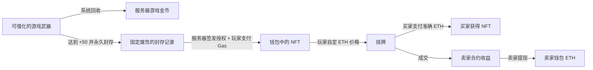

# Forge of Fate · 命运锻造所

一个用于课程演示的锻造与 NFT 游戏。玩家在三维工坊领取武器、加热强化、选择路线，用系统回收所得金币购买补给；达到 +50 的武器可以永久封存，再通过 MetaMask 铸造成 NFT。NFT 由玩家自行定价，用 **ETH** 买卖，当前演示网络为 **Ethereum Sepolia**。

**游戏金币保存在服务器，不发行 ERC-20。充值暂不做；NFT 质押产金币保留为下一阶段功能。**

[快速启动](#快速启动) · [交易规则](#nft-与交易规则) · [测试与验证](#测试与验证) · [项目计划](Forge_of_Fate_Project_Plan.md) · [链上计划](chain/链上功能与开发计划.md) · [链上目录](chain/README.md)

## 当前状态

更新于 **2026-10-30**。核心游戏、钱包绑定、NFT 与市场代码已实现；自动化使用隔离数据库和本地链。**自动测试通过不代表已完成 MetaMask + Sepolia 的人工验收。**

| 模块 | 已实现 | 尚待完成 |
|---|---|---|
| 游戏与存档 | 注册登录、每日补给、三条武器路线、强化、保护符、仓库、系统回收、金币商店、中英界面 | 根据试玩反馈调整表现 |
| 钱包绑定 | 账号内发起签名、服务器验签、一账号一钱包、绑定不搬动存档 | 换绑/解绑当前不提供 |
| 部署工作台 | 默认部署 `ForgeOfFate`；固定编译资料、MetaMask 发交易、最终确认、持久恢复、生成游戏清单 | 真实 Sepolia 部署与源码验证 |
| NFT 与交易 | 永久封存、签名铸造、挂牌/改价/撤单、购买、直接转移、卖家提现 | 双钱包 Sepolia 全流程验收 |
| 交易状态 | 校验回执、等待最终确认、刷新/关页后恢复已知哈希、跨标签页同步 | 钱包加速/取消后识别替换交易；未拿到哈希的广播恢复 |
| 链上监听 | 确认事件、归属与挂单索引、停机补扫、重复去重、区块冲突暂停 | 未来质押事件和奖励结算 |
| 游戏币 | 余额、商店扣款、系统回收、操作幂等 | 独立收支流水与精度方案 |
| NFT 质押产币 | 已保留设计与开发顺序 | 合约、接口、账本、页面均未实现 |
| 充值 / NFT 换回武器 | 保留未来扩展空间 | 暂缓，本轮不实现 |

本轮复核修复了交易确认与恢复的边界，并扩充了回调、并发购买、提现回滚和签名授权测试。详细结果和未覆盖的真实网络场景见[测试与交易审查记录](chain/测试与交易审查记录.md)。

## 快速启动

从项目根目录执行。版本提示见 [`.nvmrc`](.nvmrc) 和 [`.python-version`](.python-version)；开发环境使用 Node.js 24、Python 3.13。浏览器自动测试使用本机 Google Chrome。

```sh
npm ci
python3 -m venv .venv
.venv/bin/python -m pip install -r backend/requirements.lock.txt
cp -n .env.sepolia.example .env.sepolia
```

### Sepolia 配置与模板

编辑本机 `.env.sepolia`：

| 字段 | 内容 |
|---|---|
| `PROJECT_WALLET_ADDRESS` | MetaMask 项目钱包的公开地址，用于部署 |
| `SEPOLIA_RPC_URL` | Sepolia 节点完整连接地址，只在服务器使用 |
| `DEMO_BUYER_ADDRESS` | 可选的第二个演示钱包地址，双钱包交易前准备 |

模板见 [`.env.sepolia.example`](.env.sepolia.example)，填写方法见[开发前填写清单](chain/开发前填写清单.md)。已有配置不要覆盖；无需提供 MetaMask 私钥或助记词。

```sh
npm run check:sepolia
npm run start:demo
```

游戏：**http://127.0.0.1:5173/**。正常模式使用 `npm start`，不开放作弊菜单。启动器检查网络，启动前后端；存在 NFT 业务部署清单时同时启动监听。它不会自动部署合约。

在启动终端按 Ctrl+C 停止本次服务，数据仍保存在 `.local/sepolia/`。端口占用时先关闭旧服务。普通锻造、账号和仓库可在尚未部署 NFT 合约时使用；日常启动仍需要有效的 Sepolia 配置和节点连接。

### 普通账号与测试账号

页面可以自行注册普通账号。注册保留当前临时档案；登录已有账号切换至该账号原存档，不合并另一份存档。

```sh
npm run accounts:setup
```

此命令默认只准备 `forge_test`，角色为 `tester`；首次凭据保存在本机 `.local/sepolia/test-accounts.md`。重复运行保留已有密码、权限、钱包和进度。仅在需要独立普通测试账号时运行 `npm run accounts:setup -- --with-player`。

当前本机演示保留已绑定本人钱包的 `forge_test`。作弊菜单需同时满足 **测试模式开启 + tester 账号**；支持补资源、刷剑、调整自己未封存武器的等级和热量，生成/修改的武器标记为 DEMO。普通注册不能获得测试权限。源码不硬编码钱包归属，不分发真实游戏数据库或钱包密钥。

### 钱包注册绑定与支付

登录游戏账号 → 点击绑定钱包 → MetaMask 签署用途明确的消息 → 服务器验证签名。消息绑定账号、钱包、网站、网络、随机码和有效期。只填写地址不能证明所有权。

- 一个账号对应一个钱包，同一钱包不能绑定第二个账号；地址大小写不绕过唯一约束。
- 绑定仅证明钱包控制权，不收 Gas、不授权转账，也不迁移武器或资源。
- 切换 MetaMask 账号不会切换游戏账号。钱包或网络不匹配时，暂停链上按钮，普通游戏仍可使用。
- 链上交易另外在 MetaMask 确认，使用 Sepolia 测试 ETH 支付 Gas。

## 部署与人工演示

在单独终端执行：

```sh
npm run deploy:console
```

打开 **http://127.0.0.1:5174/deploy**。默认合约是 `ForgeOfFate`（NFT + ETH 市场）；使用配置中的项目钱包，在 MetaMask 选择 Sepolia 并确认部署。工作台固定计划和编译资料，待 `finalized` 且合约身份核验通过后生成 `.local/sepolia/deployment.json`。然后重启游戏，加载同一合约并启动监听。

部署只需建立一次合约。后续每把武器由服务器签发铸造授权，玩家向这个已有合约发送 `mint` 交易；不是每把武器部署一个新合约。

[合约部署工作台](chain/合约部署工作台.md)说明首次部署、拒签、哈希恢复和导出；[Sepolia 部署与本地服务指南](chain/Sepolia部署与本地服务指南.md)说明日常启停。可选 Probe 仅验证部署工具，不是业务合约，也不是必经步骤。

部署后按以下流程人工验收，保存交易链接：

1. 用账号 A 绑定钱包 A，正常强化或通过测试菜单准备 +50 武器。
2. 在背包确认永久封存，铭刻 NFT，核对名称、路线、等级、DEMO 标记和图片。
3. 挂牌、改价、撤单，再重新挂牌；用旧价格尝试购买应失败。
4. 用另一游戏账号绑定钱包 B，支付准确价格购买，核对 NFT 归属及卖家待提现余额。
5. 账号 A 切回钱包 A，提取收益；钱包 B 再验证直接转移会清除挂单。
6. 刷新、关闭并重开页面和本地服务，核对原部署、存档、待确认交易与确认历史。分别核对骑士剑、刺剑和巨剑的 NFT 图片。

**撤销挂单只停止出售，NFT 仍在钱包中。** 它不会解除武器封存，也不会把 NFT 换回游戏中的可强化武器。

## NFT 与交易规则

### 项目目标与链上功能

当前合约实现 ERC-721 收藏品和最小固定价市场。NFT 的链上归属以合约为准，游戏金币与 ETH 独立结算；系统回收价格不决定 NFT 售价，也不保证玩家出售成功。



| 操作 | 规则与失败边界 |
|---|---|
| 系统回收 | 消耗自己的可用武器，增加游戏金币；与封存互斥，并发不能同时成功 |
| 永久封存 | 门槛 +50，之后不能强化、回收或作弊改属性；当前没有解封功能 |
| 铭刻 | 服务器授权绑定武器 ID、接收钱包、等级、URI、到期时间、网络和部署；授权有效 10 分钟，可过期后重新获取 |
| 重复铭刻 | 同一武器 ID 在同一合约中只能铸造一次；重复授权不会产生第二个 NFT |
| 挂牌 / 改价 | 只有 NFT 持有人可操作；ETH 价格必须大于零，挂牌不转移 NFT |
| 购买 | 同时核对卖家和价格，付款必须精确匹配；旧价格、已撤单、已转走或已成交均不能再次购买 |
| 撤单 / 转移 | 只有持有人可撤单；ERC-721 转移自动清除原挂单 |
| 收款 | 成交款先累计为卖家可提取 ETH；主动提现失败时保留原收益，可重试；不增加游戏金币 |
| 接收失败 | 接收方拒绝 NFT 时整笔交易回滚，NFT、挂单与收益不发生部分变化；失败交易仍可能消耗 Gas |

服务器决定游戏结果并签发铸造资格；合约核验签名、归属、支付和交易规则，不在链上重新运行强化概率。元数据为固定 data URI，图片使用[公开图片映射](assets/NFT_Pic/manifest.json)中的固定版本链接；图片文件本身不在链上。

### 交易确认与恢复

- **已提交**：拿到交易哈希，不能当作成交。
- **已打包**：找到与当前合约、钱包和哈希相符的规范链回执；Sepolia 仍等待最终确认。
- **已最终确认**：回执区块达到节点 `finalized` 边界，才显示成功或执行失败。节点不支持最终确认时保留待处理状态，不降级判断。
- **索引已处理**：监听程序已将确认事件写入数据库并更新索引。它可能落后于钱包回执；市场最新状态读取和确认历史分别展示。

已知哈希按网络、合约、部署标识和钱包保存在 `localStorage`，刷新、关闭标签页或同一浏览器重开可以恢复；其他标签页会同步记录变化。切换账号/环境不删除原记录。清除浏览器站点数据或更换浏览器不会自动带走这些记录。

**当前限制**：钱包“加速/取消”会产生另一个交易哈希，游戏页面尚未自动追踪同 nonce 替换；在钱包已广播但页面未拿到哈希时，也尚无自动找回。遇到此类情况先核对 MetaMask / 浏览器交易记录，不根据超时认定失败，也不要盲目重新提交。相关恢复功能列为下一步 P0。

## 游戏玩法与数值

### 工坊补给与价格

| 来源 / 消费 | 当前规则 |
|---|---|
| 每日补给 | 200 铁块 + 5 保护符；每日另可领取 3 把 +0 普通剑，UTC 零点重置 |
| 锻造一把普通剑 | 10 铁块，初始 +0 |
| 金币买一把普通剑 | 2,500 金币，初始 +0 |
| 铁块包 | 5,000 金币买 20 铁块 |
| 保护符 | 2,500 金币买 1 张 |
| 加热 | 2 铁块，等待 3 秒，可敲 5 锤 |
| 每次敲击 | 基础剑 2 铁块；进入路线阶段后骑士剑 4、刺剑 3、巨剑 7 |
| 回收 | +0 为 1,000 金币；其余按路线与等级锚点插值，保留已确定的回收价 |
| 路线最高级 | 骑士剑 +90、刺剑 +80、巨剑 +70 |

10 铁块按商店折算为 2,500 金币，与直接买普通剑一致。买来的 +0 剑直接回收为 1,000，不构成即时金币套利。高等级回收价按课程演示设计保留，尚未作为长期运营经济模型验证。

### 保护符与 Q 快捷键

Q 或面板勾选框控制是否启用，面板显示剩余张数。只有实际挡住一次损毁才消耗 1 张，并关闭本次保护；普通成功、大成功和降级不消耗，阶段免损毁保护优先生效。缺少保护符时服务器不会先掷随机数再回滚。输入文字、弹窗和不适用状态下 Q 不触发。

### 武器仓库与继续锻造

工坊最多取用一把武器，仓库保存其余武器。取出/存入、热量、等级和路线写入数据库；多标签页通过版本校验避免对过期武器状态扣资源。第一人称使用 WASD 移动、E 交互、Esc 退出控制，也可切换环绕视角。

### 3D 资产放在哪里

完整操作、数值锚点和武器升级版图见[游戏规则与素材](docs/游戏规则与素材.md)。模型位于 [assets/3d](assets/3d/README.md)，透明展示图见 [assets/display](assets/display/README.md)，NFT 图见 [assets/NFT_Pic](assets/NFT_Pic/README.md)，世界观和三条路线故事见 [assets/stories](assets/stories/README.md)。界面支持中英文，语言选择不影响存档或 NFT 元数据。

## 数据库与存档说明

游戏使用 SQLite，不需要单独数据库服务。当前环境 `.local/sepolia/game.sqlite3` 与历史本地 `.local/game.sqlite3` 隔离，不能混用。

| 数据 | 事实来源 |
|---|---|
| 账号、角色、资源、普通武器、强化、回收 | 游戏数据库；写操作使用数据库事务和幂等请求标识 |
| 钱包绑定 | 一次性签名验证 + 独立绑定表；内部存档地址不是钱包证明 |
| NFT 所有权、挂牌、ETH 收益 | 合约；数据库保存已确认事件及其索引 |
| 部署恢复 | `.local/sepolia/deploy-console/forge-of-fate/` 固定计划、编译资料和状态 |
| 游戏合约配置 | `.local/sepolia/deployment.json`；不能用 Probe 清单替代 |
| 铸造授权 | `.local/sepolia/mint-key`，服务器专用密钥，权限 0600；不是玩家 MetaMask 私钥 |

卖家提现目前没有独立合约事件，确认历史不提供完整提现流水；`operations` 是防重试记录，不能当作完整游戏币账本。

### 数据结构升级与备份

旧存档升级保留账号、资源与武器；具体表结构、权限和在线备份命令见[数据库与存档维护](docs/数据库与存档.md)。活跃 SQLite 使用 WAL，不要只复制主文件作为完整备份。备份数据库、原部署清单和铸造授权密钥；已有计划缺失密钥时应恢复原文件，不重新生成替代密钥。

测试使用临时目录，不清理当前 `forge_test` 或真实钱包绑定。启动服务、关闭服务及运行测试均不会重置正式游戏存档。

## 测试与验证

```sh
npm test
```

依次运行所有测试族，失败后仍继续检查其余部分，并在 `.local/test-runs/<时间>/` 保存各组日志和 `results.json`；全部通过才返回成功。需要允许本机启动临时服务、浏览器和隔离测试链，不需要真实钱包或 Sepolia 转账。

| 单独命令 | 验证内容 |
|---|---|
| `npm run test:contracts` | 签名、市场、并发购买、接收回调、收益与提现回滚 |
| `npm run test:backend` | 游戏规则、商店/回收、幂等/并发、账号权限、钱包证明、RPC、索引恢复 |
| `npm run test:deploy:service` | 固定部署计划、最终确认、密钥、编译资料与文件发布恢复 |
| `npm run test:client` | 待确认记录持久化、身份隔离与回执校验 |
| `npm run test:browser` | 全部游戏/链上页面交互、双语布局、错误恢复与部署工作台 |
| `npm run test:i18n -w frontend` | 翻译完整性、模板参数与双语组件 |
| `npm run test:lore -w frontend` | 三条路线故事与武器身份匹配 |
| `npm run test:models -w frontend` | TypeScript 检查、生产构建、开发与预览素材服务 |
| `npm run verify:game` | 隔离真实节点 + API 的锻造、三路线 NFT、交易、提现、转移与停机补扫闭环 |

本轮命令、计数、修复和验收边界见[测试与交易审查记录](chain/测试与交易审查记录.md)。保留的警告主要为前端包体较大、SSR 检查中 Three.js 重复导入及 Python 依赖弃用提示。全量自动测试不能保证所有网络/钱包行为都已覆盖，也不能替代真实 Sepolia 验收。

## 后续还缺什么

详见[下一阶段开发计划](chain/链上功能与开发计划.md)，按下面顺序推进：

1. **完成交易恢复 P0**：识别加速/取消交易、恢复未拿到哈希的广播，补真实交易页面发送阶段测试。
2. **实际跑通 Sepolia**：部署 NFT 合约、三路线铭刻、双钱包买卖/提现、关页恢复与停机补扫，保留公开证据。
3. **游戏币账本**：统一回收、商店和测试发放的收支流水，明确金额单位与精度，为奖励结算打基础。
4. **NFT 质押用途**：确认速率、离线累计、取回限制等参数后实现；取回停产，已得金币不退还，累计产币暂不封顶。
5. **整理交付材料**：源码版本、公开部署信息、测试结果、演示视频、备份与恢复说明。

充值与 NFT 换回可强化武器继续暂缓。课程演示完成前不追加新的代币或复杂经济机制。

## 目录与 Git

```text
frontend/             React / Three.js 游戏和部署工作台界面
backend/              游戏 API、规则、账号、SQLite 存储
chain/contracts/      生产 Solidity 合约
chain/client/         浏览器链上交易记录与回执校验
chain/server/         RPC、铸造授权、钱包证明、监听和链上索引
chain/scripts/        部署、网络检查、监听入口、隔离闭环验证
chain/test/           Hardhat 合约测试及测试用接收方
chain/tests/          Python / Node / 浏览器链上测试
scripts/              游戏启动、账号准备、全量测试入口
backend/tests/        游戏与数据库测试
frontend/tests/       素材、翻译、故事检查
tests/browser/        游戏浏览器测试及共享隔离环境
assets/               模型、配置、图片与故事
docs/                 游戏细节、数据库维护
.local/               本机存档、密钥、部署状态、日志及测试产物（不提交）
```

### Git 忽略与提交范围

提交源码、依赖锁文件、空配置模板、规则与素材、测试、README 和计划。`.gitignore` 排除真实 `.env*`、`.local/`、数据库、授权密钥、密码说明、浏览器状态、测试报告、日志、依赖和构建产物；忽略规则不能替代对已跟踪文件的检查。不要把钱包私钥、助记词或当前用户数据库放入作业仓库。

链上导航：[实现状态](chain/README.md) · [计划](chain/链上功能与开发计划.md) · [部署工作台](chain/合约部署工作台.md) · [监听与恢复](chain/链上监听与恢复.md) · [页面与存档一致性](chain/本地测试与页面数据一致性.md) · [本轮复核](chain/测试与交易审查记录.md)
