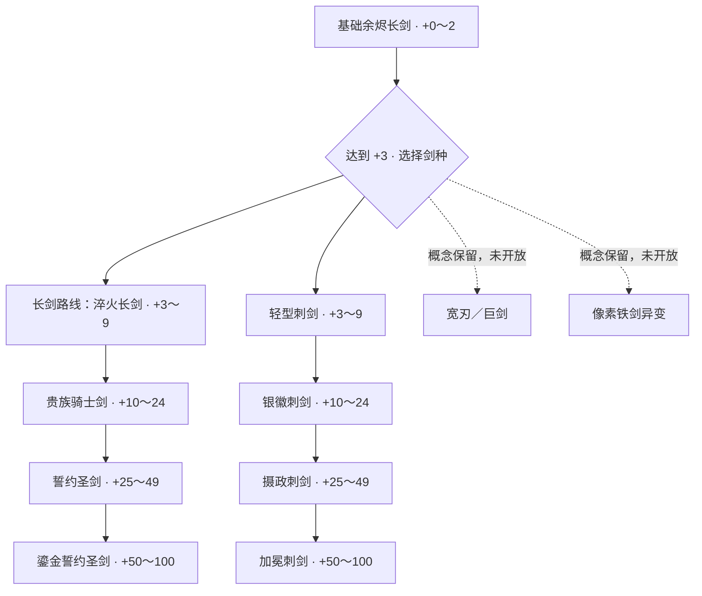

# 3D 模型与升级版图

更新日期：2026-10-24。当前落盘并接入 **6 把剑 + 1 把锻造锤**。刺剑已配置四个升级档位，高阶新模型待制作，当前复用基础刺剑模型。

## 当前可以玩的路线

“二级剑”指美术外观档次，**不等于强化 +2**；当前二级分支从强化 **+3** 开放。强化等级仍是 +0～+100，NFT 封存门槛仍为 +50。

## 模型清单

| 文件 | 识别结果／用途 | 状态 |
|---|---|---|
| `sword.glb` | 旧钢、磨损皮柄，余烬长剑 | 两条路线共用的起点 |
| `sword-upgraded.glb` | 朴素钢制标准长剑 | 长剑 +3 起 |
| `nobel+knight+sword+3d+model.glb` | 蓝宝石与金边的贵族骑士剑 | 长剑 +10 起 |
| `fantasy+sword+3d+model.glb` | 翼形护手、蓝宝石的誓约圣剑 | 长剑 +25 起 |
| `top+fantasy+sword+model.glb` | 更多金色剑身纹样的鎏金圣剑 | 长剑 +50 起，场景长度略增加 |
| `medieval+sword+model.glb` | 无护手环的轻型刺剑，弧形横护手 | 刺剑 +3 起；2,244 三角面，约 276 KiB |
| `hammer.glb` | 锻造锤 | 交互工具，不属于升级树 |

新刺剑已通过实际渲染确认；文件名中的 `medieval` 不能用于判断剑种。当前保留原文件名，通过配置映射。

## 当前程序规则

- 在锻造页的 **Weapon type** 选择框切换长剑／轻型刺剑，要求武器未封存且等级至少 +3。
- 当前试玩版允许免费切换，不新增材料消耗，也未引入战斗属性差异。后续是否锁定分支另行决定。
- 剑种存入数据库，刷新、重新登录、强化和降级都保留。旧存档默认归为长剑，无需清空数据。
- 低于 +3 时两条路线共用基础外观；升回 +3 后恢复所选路线。刺剑在高等级继续用现有刺剑模型，不会换成贵族剑或圣剑。
- 刺剑以女性宫廷角色的权力与优雅为设计方向：+10 银徽、+25 摄政、+50 加冕；名称随当前等级升降，长度依次为 3.5 / 3.5 / 3.6 / 3.7。高阶设计描述已记录在配置的 `design` 字段，尚未制作对应新模型。
- 模型与名称在铁砧、手持、熔炉和展示柜保持一致。背包使用服务端返回的名称。
- 封存后不可切换剑种。新铸造 NFT 的名称及 `Weapon Type` 属性记录当前路线；不重写已有 NFT。
- 现有强化概率、消耗、保护机制、最高等级和 +50 NFT 门槛不变。

## 配置与维护

- `sword-tiers.json`：两条路线的等级门槛、名称、模型与场景长度；`branch` 区分 `longsword` 与 `rapier`，各路线内部按 `min_level` 升序排列。刺剑的 `design` 字段记录后续模型的美术方向。
- `sword-branches.json`：已开放剑种、解锁等级及可选的分支档位覆盖；`tiers: null` 表示按剑种从 `sword-tiers.json` 读取档位。
- `backend/game.py`：根据等级及剑种解析外观；`backend/app.py` 保存分支，并校验所有权、等级及封存状态。
- `frontend/src/swordTiers.ts`：前端使用相同配置；`frontend/vite.config.ts` 自动服务并打包配置里的模型。
- 修改配置后重启后端，重启开发前端或重新构建。新增剑种还需更新服务端 `BranchChoice` 白名单并补测，不能仅添加文件。

## 暂不接入的设计

用户确认巨剑和像素剑的 3D 生成效果不满意，目前没有可用 GLB；保留参考图，不显示为已解锁分支，也不自动生成替代模型。

| 设计 | 已有参考图 | 当前状态 |
|---|---|---|
| 朴素宽刃重剑 | `../reference_page/sword_branches/tier2-heavy-broadsword-four-view.png` | 概念保留 |
| 基础巨剑 | `../reference_page/sword_branches/tier2-colossal-greatsword-four-view-v2.png` | 暂缓接入 |
| 方块铁巨剑 | `../reference_page/sword_branches/voxel-iron-greatsword-front.png` | 暂缓接入；一锤像素异变效果尚未实现 |
| 无环轻型刺剑 | `../reference_page/sword_branches/tier2-elegant-rapier-no-loop-v2.png` | 已有 GLB 并接入 |

以下为原有资产规范及长剑主线详细尺寸，仍供维护参考。

---

## 资产投放目录

把生成的模型直接放在本文件夹。开发服务器会从这里读取，不需要复制到其他位置。暂时缺少模型时，页面自动使用程序生成的占位模型。

## 请优先生成

| 文件名 | 模型 | 优先级 | 要求 |
|---|---|---|---|
| `sword.glb` | 双刃长剑 | 高 | 完整单把剑，深色金属剑身、旧皮革握柄，剑身不带火焰和背景 |
| `hammer.glb` | 锻造锤 | 高 | 单个铁匠锤，深色方形金属锤头、木质或旧皮革握柄，不带手和人物 |
| `anvil.glb` | 铁砧 | 可选 | 单个传统铁砧，深色旧金属；已有程序占位，无需急着生成 |

## 统一规格

- 风格：Stylized Dark Fantasy，低面数，造型清楚，避免极细零件。
- 格式：单个 `.glb`，贴图嵌入文件，不依赖外置纹理路径。
- 不带场景、地面、人物、灯光和相机；无需骨骼或动画。
- 原点尽量在物体中心，Y 轴向上，应用旋转与缩放。
- 长剑沿 Y 轴，剑尖朝 +Y；锤柄沿 Y 轴，锤头位于 +Y 端。若生成器不能保证方向也可以，交付时说明即可。
- 基础刀剑建议以 **5,000 三角面（tris）** 为生成目标，常规范围 **3,000–8,000 tris**；普通版本尽量不超过 **10,000 tris**。这是本项目的初始资产预算，不是引擎硬性上限；此前通用的 5,000–30,000 范围对基础刀剑偏宽。
- 如工具区分拓扑，游戏交付选择三角面；编辑源文件可以用四边面，导出 GLB 时会三角化。5,000 tris 大约相当于 2,500 个四边面，混合拓扑时以导出后的统计为准。
- 基础刀剑使用 1 套 PBR 材质，最多 2 个材质槽；基础色、法线、粗糙度／金属度贴图以 1K（1024×1024）为默认。需要近距离看刀纹时可以升至 2K，首版无需 4K。细小划痕通过贴图表达，不必堆面数。
- 刀剑 GLB 目标 1–5 MB，尽量小于 10 MB；文件体积主要也受贴图影响，不能单凭面数推算。
- 基础刀剑为刚性静态网格，不需要骨骼、蒙皮和内置动画；锻造运动由程序控制。
- 当前已支持长剑与轻型刺剑两条路线；其余剑种暂不增加生成预算。

## 可以直接使用的生成描述

### 长剑

Stylized dark fantasy blacksmith longsword, one complete double-edged sword, dark forged steel blade, simple worn leather grip, restrained bronze crossguard, readable low-poly silhouette, game-ready PBR materials, isolated object, no background, no ground, no character, no hand, no glow effects, no animation. Blade aligned vertically, tip pointing upward.

### 锻造锤

Stylized dark fantasy blacksmith forging hammer, one complete hammer, heavy rectangular dark iron head, short worn wooden handle with leather wrapping, readable low-poly silhouette, matching a dark forged steel longsword, game-ready PBR materials, isolated object, no background, no ground, no character, no hand, no animation.

## 我会用程序制作的内容

铁砧占位、石质底座、地面、炉火与余烬、矿石、材料箱、简单锤剑占位、发光、火花和碎片。这些不需要你提前生成。

放入模型后刷新页面即可。剑模型文件名需与 `sword-tiers.json` 一致；模型加载失败时会回退到占位模型。复杂模型的后续新增需求统一记录在本文件中。

## 预算说明与参考

以上面数、贴图及体积是针对本项目单把基础刀剑展示的建议，尚不是在目标设备上测得的性能上限。运行表现也取决于材质数量、贴图、阴影与画面分辨率。收到模型后再检查实际导出面数与显示效果。

Blender 导出 glTF 时会把四边面和多边面转换为三角面：[Blender glTF 导出说明](https://docs.blender.org/manual/en/3.3/addons/import_export/scene_gltf2.html)。

## 工坊新增陈列

展示柜、房间背墙、结构木梁与地面网格已由程序生成，目前不需要额外生成这些模型。已支持工坊环绕视角、第一人称移动与长剑拿放；现有长剑模型可直接用于台面、手持和柜内展示。

## 已接入的锻造锤

用户提供的 `fantasy+hammer+3d+model.glb` 已改名为 `hammer.glb` 并接入。模型约 396 KB、2,418 个三角面。锤子不再作为场景中的悬浮物；第一人称走近铁砧且剑位于台面时自动取出，拿起剑、离开铁砧、将剑放入展示柜或切换环绕模式时自动收起，取用与收起有短暂过渡动画。

## Five-stage sword progression

The shared source of truth is `sword-tiers.json`. Each tier's `branch` selects its route; branch definitions live in `sword-branches.json`. Both backend and frontend share these files; Vite serves and packages every listed model, including filenames containing `+`. Rapier stages at +3 / +10 / +25 / +50 currently reuse the existing rapier GLB while their new designs await production.

| Level | Appearance | Model | Scene length |
|---|---|---|---|
| +0–2 | 余烬长剑 | `sword.glb` | 3.5 |
| +3–9 | 淬火长剑 | `sword-upgraded.glb` | 3.5 |
| +10–24 | 贵族骑士剑 | `nobel+knight+sword+3d+model.glb` | 3.5 |
| +25–49 | 誓约圣剑 | `fantasy+sword+3d+model.glb` | 3.6 |
| +50–100 | 鎏金誓约圣剑 | `top+fantasy+sword+model.glb` | 3.85 |

Thresholds are provisional. Edit `min_level` in ascending order within each branch, keeping the shared longsword base stage at zero, then restart the backend and rebuild/restart the frontend. `size` controls normalized model length. The final sword is slightly longer instead of being normalized to the base sword's size.

Within each route, appearance follows current level, including double upgrades and downgrades. The chosen weapon type persists separately. The anvil, furnace, held sword and cabinet share the same selection. Sealed weapons keep their level. Newly minted metadata uses the matching name; existing on-chain metadata is not rewritten. NFT eligibility remains +50, and forging odds/costs are unchanged.

Five sword GLBs were inspected: 2,492–4,025 triangles and approximately 0.51–1.65 MB each, embedded textures, aligned on the Y axis. Their supplied geometry has the tip toward -Y. Existing scene rotations are retained. These five assets form the longsword route. The additional rapier GLB is a parallel branch; concept images alone do not create playable stages.
