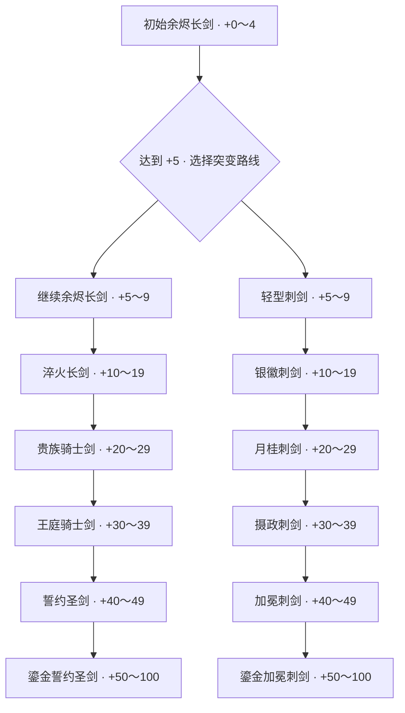

# 3D 模型与升级版图

更新日期：2026-10-24。当前已接入 **12 把剑 + 1 把锻造锤**：共用初始剑 1 把、骑士剑进阶模型 5 把、刺剑模型 6 把。所有现有武器 GLB 均有实际用途，各阶段不再复用临时模型。

## 当前可以玩的路线

初始剑达到 **+5** 后可在锻造页主动选择突变为刺剑，也可继续骑士剑路线。突变选择免费，封存前可切换。骑士剑按 +0 / +10 / +20 / +30 / +40 / +50 升级；刺剑在 +5 增加基础突变形态，再于 +10 / +20 / +30 / +40 / +50 逐级升级。两条路线 **+50 以后保持最终名称、模型和长度**，强化仍可继续到 +100，NFT 封存门槛仍为 +50。

| 等级 | 骑士剑路线 | 刺剑路线 |
|---|---|---|
| +0～4 | 余烬长剑 | 共用余烬长剑，尚未开放突变 |
| +5～9 | 余烬长剑 | 轻型刺剑，基础突变形态 |
| +10～19 | 淬火长剑 | 银徽刺剑 |
| +20～29 | 贵族骑士剑 | 月桂刺剑 |
| +30～39 | 王庭骑士剑 | 摄政刺剑 |
| +40～49 | 誓约圣剑 | 加冕刺剑 |
| +50～100 | 鎏金誓约圣剑 | 鎏金加冕刺剑 |

## 模型清单

下列路径均相对本目录；配置中的 `model` 省略 `.glb`。

| 文件 | 名称／用途 | 等级 |
|---|---|---|
| `sword.glb` | 余烬长剑，共用初始剑 | +0 起 |
| `knight sword/l0-sword-upgraded.glb` | 淬火长剑 | +10 起 |
| `knight sword/l1-nobel+knight+sword+3d+model.glb` | 贵族骑士剑 | +20 起 |
| `knight sword/l2-fantasy+sword+3d+model.glb` | 王庭骑士剑 | +30 起 |
| `knight sword/l3-fantasy+sword+model.glb` | 誓约圣剑 | +40 起 |
| `knight sword/best+fantasy+sword+3d+model.glb` | 鎏金誓约圣剑，骑士终阶 | +50 起 |
| `rapier/l0-slim sowrd.glb` | 轻型刺剑，基础突变 | +5 起 |
| `rapier/l1-slim-sword+3d+model.glb` | 银徽刺剑，银色鸢尾盾徽 | +10 起 |
| `rapier/l2-slim-sword+3d+model.glb` | 月桂刺剑，月桂与暖金细节 | +20 起 |
| `rapier/l3-slim+sword+3d+model.glb` | 摄政刺剑，王权纹章 | +30 起 |
| `rapier/l4-rapier+3d+model.glb` | 加冕刺剑，完整冠冕与金色镶嵌 | +40 起 |
| `rapier/l5-rapier+3d+model.glb` | 鎏金加冕刺剑，红宝石皇冠剑首，刺剑终阶 | +50 起 |
| `hammer.glb` | 锻造锤，交互工具 | 不属于升级树 |

保留用户提供的实际文件名，包括 `l0-slim sowrd.glb` 中的拼写。刺剑六张概念图位于 `../reference_page/Rapier/`，按 l0～l5 对应上述六把刺剑。

## 当前程序规则

- 在锻造页的“突变路线”选择框切换骑士剑／刺剑，要求武器未封存且等级至少 +5。默认继续骑士剑路线，突变由玩家主动选择。
- 当前试玩版允许免费切换；剑种不影响强化概率、材料消耗或战斗属性。
- 剑种存入数据库，刷新、重新登录、强化和降级都保留。旧存档默认归为骑士剑，无需清空数据。
- 刺剑降至 +5 以下时恢复共用余烬长剑外观，剑种选择仍保留；升回 +5 后自动恢复基础刺剑。其余节点的升级和降级也跟随当前等级切换。
- 铁砧、手持、熔炉、展示柜和背包使用同一条路线与当前阶段；+50～100 的最终外观不再变化。
- 刺剑依次采用 3.5 / 3.5 / 3.55 / 3.6 / 3.7 / 3.85 的场景长度。终阶皇冠内部是一颗大红宝石，设计描述已同步至配置。
- 封存后不可切换剑种。新铸造 NFT 的名称及 `Weapon Type` 属性记录当前路线；已有 NFT 元数据不重写。
- 强化概率、消耗、保护机制、最高 +100 和 +50 封存门槛沿用当前数值。

## 配置与维护

- `sword-tiers.json`：所有阶段的等级门槛、名称、模型与场景长度；`branch` 区分 `longsword` 与 `rapier`，各路线内部按 `min_level` 升序排列。`design` 记录对应武器的美术特征。现有模型均已接入，没有临时模型标记。
- `sword-branches.json`：路线名称与突变解锁等级，目前两条路线均为 +5；`tiers: null` 表示按剑种从 `sword-tiers.json` 读取阶段。内部 ID 保留 `longsword` / `rapier`，兼容已有存档。
- `backend/game.py`：根据等级及剑种解析外观；`backend/app.py` 保存分支，并校验所有权、等级及封存状态。
- `frontend/src/swordTiers.ts`：前端使用相同配置，刺剑路线自动补上共用的 +0 初始剑；`frontend/vite.config.ts` 服务并打包配置引用的模型。
- 修改配置后重启后端，重启开发前端或重新构建。新增剑种还需更新服务端 `BranchChoice` 白名单并补测。
- 验证：`npm run test:backend` 检查等级、突变、降级与元数据；`npm run test:models -w frontend` 构建并检查开发／预览中的实际模型请求。

## 暂不接入的设计

用户确认巨剑和像素剑的 3D 生成效果不满意，目前没有可用 GLB；保留参考图，不显示为已解锁分支，也不自动生成替代模型。

| 设计 | 已有参考图 | 当前状态 |
|---|---|---|
| 朴素宽刃重剑 | `../reference_page/sword_branches/tier2-heavy-broadsword-four-view.png` | 概念保留 |
| 基础巨剑 | `../reference_page/sword_branches/tier2-colossal-greatsword-four-view-v2.png` | 暂缓接入 |
| 方块铁巨剑 | `../reference_page/sword_branches/voxel-iron-greatsword-front.png` | 暂缓接入；一锤像素异变效果尚未实现 |
| 无环轻型刺剑 | `../reference_page/sword_branches/tier2-elegant-rapier-no-loop-v2.png` | 已有 GLB 并接入 |

以下为原有资产规范及长剑主线详细尺寸，仍供维护参考。

---

## 资产投放目录

把生成的模型放在本文件夹或其子文件夹。`sword-tiers.json` 的 `model` 填写相对此目录的路径，省略 `.glb`，例如 `knight sword/l0-sword-upgraded`；路径可包含空格和 `+`。开发服务器按该路径读取，构建时保留子文件夹结构，不需要手动复制。暂时缺少模型时，页面自动使用程序生成的占位模型。

## 请优先生成

| 文件名 | 模型 | 优先级 | 要求 |
|---|---|---|---|
| `sword.glb` | 双刃长剑 | 高 | 完整单把剑，深色金属剑身、旧皮革握柄，剑身不带火焰和背景 |
| `hammer.glb` | 锻造锤 | 高 | 单个铁匠锤，深色方形金属锤头、木质或旧皮革握柄，不带手和人物 |
| `anvil.glb` | 铁砧 | 可选 | 单个传统铁砧，深色旧金属；已有程序占位，无需急着生成 |

## 统一规格

- 风格：Stylized Dark Fantasy，低面数，造型清楚，避免极细零件。
- 格式：单个 `.glb`，贴图嵌入文件，不依赖外置纹理路径。
- 不带场景、地面、人物、灯光和相机；无需骨骼或动画。
- 原点尽量在物体中心，Y 轴向上，应用旋转与缩放。
- 长剑沿 Y 轴，剑尖朝 +Y；锤柄沿 Y 轴，锤头位于 +Y 端。若生成器不能保证方向也可以，交付时说明即可。
- 基础刀剑建议以 **5,000 三角面（tris）** 为生成目标，常规范围 **3,000–8,000 tris**；普通版本尽量不超过 **10,000 tris**。这是本项目的初始资产预算，不是引擎硬性上限；此前通用的 5,000–30,000 范围对基础刀剑偏宽。
- 如工具区分拓扑，游戏交付选择三角面；编辑源文件可以用四边面，导出 GLB 时会三角化。5,000 tris 大约相当于 2,500 个四边面，混合拓扑时以导出后的统计为准。
- 基础刀剑使用 1 套 PBR 材质，最多 2 个材质槽；基础色、法线、粗糙度／金属度贴图以 1K（1024×1024）为默认。需要近距离看刀纹时可以升至 2K，首版无需 4K。细小划痕通过贴图表达，不必堆面数。
- 刀剑 GLB 目标 1–5 MB，尽量小于 10 MB；文件体积主要也受贴图影响，不能单凭面数推算。
- 基础刀剑为刚性静态网格，不需要骨骼、蒙皮和内置动画；锻造运动由程序控制。
- 当前已支持骑士剑与刺剑两条路线；其余剑种暂不增加生成预算。

## 可以直接使用的生成描述

### 长剑

Stylized dark fantasy blacksmith longsword, one complete double-edged sword, dark forged steel blade, simple worn leather grip, restrained bronze crossguard, readable low-poly silhouette, game-ready PBR materials, isolated object, no background, no ground, no character, no hand, no glow effects, no animation. Blade aligned vertically, tip pointing upward.

### 锻造锤

Stylized dark fantasy blacksmith forging hammer, one complete hammer, heavy rectangular dark iron head, short worn wooden handle with leather wrapping, readable low-poly silhouette, matching a dark forged steel longsword, game-ready PBR materials, isolated object, no background, no ground, no character, no hand, no animation.

## 我会用程序制作的内容

铁砧占位、石质底座、地面、炉火与余烬、矿石、材料箱、简单锤剑占位、发光、火花和碎片。这些不需要你提前生成。

放入模型后刷新页面即可。剑模型文件名需与 `sword-tiers.json` 一致；模型加载失败时会回退到占位模型。复杂模型的后续新增需求统一记录在本文件中。

## 预算说明与参考

以上面数、贴图及体积是针对本项目单把基础刀剑展示的建议，尚不是在目标设备上测得的性能上限。运行表现也取决于材质数量、贴图、阴影与画面分辨率。收到模型后再检查实际导出面数与显示效果。

Blender 导出 glTF 时会把四边面和多边面转换为三角面：[Blender glTF 导出说明](https://docs.blender.org/manual/en/3.3/addons/import_export/scene_gltf2.html)。

## 工坊新增陈列

展示柜、房间背墙、结构木梁与地面网格已由程序生成，目前不需要额外生成这些模型。已支持工坊环绕视角、第一人称移动与长剑拿放；现有长剑模型可直接用于台面、手持和柜内展示。

## 已接入的锻造锤

用户提供的 `fantasy+hammer+3d+model.glb` 已改名为 `hammer.glb` 并接入。模型约 396 KB、2,418 个三角面。锤子不再作为场景中的悬浮物；第一人称走近铁砧且剑位于台面时自动取出，拿起剑、离开铁砧、将剑放入展示柜或切换环绕模式时自动收起，取用与收起有短暂过渡动画。

## Runtime asset checks

All 12 sword GLBs and the forging hammer are connected. Sword geometry ranges from 2,107 to 4,367 triangles; textures are embedded, with no external image or buffer dependencies. The supplied assets use Y as their longest axis, and existing scene rotations are retained.

The catalog is authoritative for names, models, stage thresholds and normalized lengths. Knight stages remain +0 / +10 / +20 / +30 / +40 / +50. Rapier adds a +5 mutation stage before +10 / +20 / +30 / +40 / +50, sharing the initial sword below +5. Both routes retain their final appearance from +50 through +100. The player's selected branch survives downgrades, and sealed weapons remain fixed.
