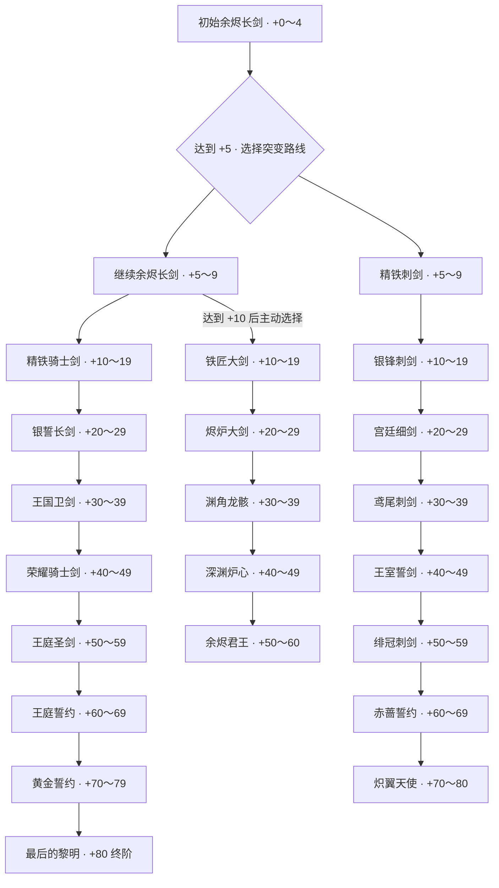

# 3D 模型与升级版图

更新日期：2026-10-25。当前已接入 **22 把剑 + 1 把锻造锤**：共用初始剑 1 把、骑士剑进阶模型 8 把、刺剑模型 8 把、巨剑模型 5 把。所有现有武器 GLB 均有实际用途，各阶段不再复用临时模型。

武器的整体故事基调、暂定传说与后续单件词条写作约定见 [世界观与武器故事](../stories/README.md)。[三条路线与 21 件武器介绍框架](../stories/weapons/README.md) 已按各阶段分别建档，记录命名含义与叙事方向。世界观和单件故事仍属暂定框架；三条路线的武器名称已按正式命名表确定，中英文与对应模型以本文件及配置表为准。

[刺剑路线](../stories/weapons/rapier.md) 已补入绯翼骑士团的“庇护与传承”主线及八阶介绍草稿，分为宫廷荣光、绯冠誓约、天使守望三个阶段；当前模型和参考图保持不变。

## 正式中英文命名

2026-10-25 按三份正式命名表统一骑士剑、刺剑与熔核重剑的中英文名称。完整对应关系见下方模型清单；共用初始剑不在三份表中，保留“余烬长剑”，英文为 **Ember Longsword**。

- `sword-tiers.json` 每一阶的 `name` 为中文、`name_en` 为英文，两者共用同一 `id`、`branch`、`min_level` 与 `model`。`sword-branches.json` 同样提供路线的 `name`／`name_en`。本次不修改原模型、参考图文件名或内部 ID。
- 后端 `weapon_name(level, branch, locale='zh')` 默认中文，`locale='en'` 返回对应英文；`/api/state` 的每把武器同时提供 `name`、`name_en` 和 `tier_id`。降级回退与终阶区间在两种语言中使用同一个阶段。
- 前端 `localizedName(value, locale='zh')` 统一读取中文或英文。已有工坊、背包、武器选择与测试面板继续显示正式中文名；整套界面语言切换留待后续制作。
- 新生成的 NFT 元数据同时包含带 DEMO 标记及强化等级的 `name`、`name_en`，并附 `tier_id`。已铸造 NFT 沿用原本固定的名称和元数据，不重新生成；旧元数据缺少英文名时保留原名称。
- 正式终阶名称为 **最后的黎明 / The Last Dawn**、**余烬君王 / Sovereign of Ash**、**炽翼天使 / Seraph's Wing**。故事框架与各武器独立故事继续单独维护。

## 当前可以玩的路线

基础剑达到 **+5** 后可主动选择刺剑；达到 **+10** 后可主动选择巨剑，也可继续骑士剑路线。不会自动变成巨剑。切换免费，要求当前等级达到目标路线门槛、未超过目标路线最高等级，且武器尚未封存。骑士剑按 +0 / +10 / +20 / +30 / +40 / +50 / +60 / +70 / +80 升级，刺剑额外包含 +5 基础形态，巨剑从 +10 起每十级更换独立模型。骑士剑最高 **+80**、巨剑最高 **+60**，刺剑最高 **+80**；NFT 封存门槛仍为 +50。骑士剑 +70／+80 模型及参考图均已接入，待补外观列表已清空；+80 正式名称为“最后的黎明 / The Last Dawn”。巨剑 +50～+60、刺剑 +70～+80 保持各自最终外观。

同一路线在相邻节点之间沿用前一阶段外观；超过路线最高等级的节点记为“—”。

| 等级节点 | 骑士剑路线 | 刺剑路线 | 巨剑路线 |
|---|---|---|---|
| +0 | 余烬长剑 | 共用余烬长剑 | 共用余烬长剑 |
| +5 | 余烬长剑 | 精铁刺剑 | 共用余烬长剑，尚未开放巨剑选择 |
| +10 | 精铁骑士剑 | 银锋刺剑 | 铁匠大剑 |
| +20 | 银誓长剑 | 宫廷细剑 | 烬炉大剑 |
| +30 | 王国卫剑 | 鸢尾刺剑 | 渊角龙骸 |
| +40 | 荣耀骑士剑 | 王室誓剑 | 深渊炉心 |
| +50 | 王庭圣剑 | 绯冠刺剑 | 余烬君王 |
| +60 | 王庭誓约 | 赤蔷誓约 | 余烬君王，达到上限 |
| +70 | 黄金誓约 | 炽翼天使 | — |
| +80 | 最后的黎明，达到上限 | 炽翼天使，达到上限 | — |

## 模型清单

下列路径均相对本目录；配置中的 `model` 省略 `.glb`。

| 文件 | 中文名称 | 英文名称 | 等级 |
|---|---|---|---|
| `sword.glb` | 余烬长剑 | Ember Longsword | +0 起 |
| `KnightSword/+10KnightSword.glb` | 精铁骑士剑 | Knight's Iron Sword | +10 起 |
| `KnightSword/+20KnightSword.glb` | 银誓长剑 | Silver Oath | +20 起 |
| `KnightSword/+30KnightSword.glb` | 王国卫剑 | Kingdom Guardian | +30 起 |
| `KnightSword/+40KnightSword.glb` | 荣耀骑士剑 | Blade of Valor | +40 起 |
| `KnightSword/+50KnightSword.glb` | 王庭圣剑 | Royal Court Blade | +50 起 |
| `KnightSword/+60KnightSword.glb` | 王庭誓约 | Royal Oathblade | +60 起 |
| `KnightSword/+70KnightSword.glb` | 黄金誓约 | Golden Oath | +70 起 |
| `KnightSword/+80KnightSword.glb` | 最后的黎明 | The Last Dawn | +80 |
| `rapier/+5rapier.glb` | 精铁刺剑 | Iron Rapier | +5 起 |
| `rapier/+10rapier.glb` | 银锋刺剑 | Silverthorn | +10 起 |
| `rapier/+20rapier.glb` | 宫廷细剑 | Courtly Rapier | +20 起 |
| `rapier/+30rapier.glb` | 鸢尾刺剑 | Fleur-de-Lis | +30 起 |
| `rapier/+40rapier.glb` | 王室誓剑 | Royal Vow | +40 起 |
| `rapier/+50rapier.glb` | 绯冠刺剑 | Crimson Crown | +50 起 |
| `rapier/+60rapier.glb` | 赤蔷誓约 | Scarlet Oath | +60 起 |
| `rapier/+70rapier.glb` | 炽翼天使 | Seraph's Wing | +70～+80 |
| `GreatSword/+10GreatSword.glb` | 铁匠大剑 | Blacksmith's Greatsword | +10 起 |
| `GreatSword/+20GreatSword.glb` | 烬炉大剑 | Emberforged Greatsword | +20 起 |
| `GreatSword/+30GreatSword.glb` | 渊角龙骸 | Abyssal Dragonbone | +30 起 |
| `GreatSword/+40GreatSword.glb` | 深渊炉心 | Abyssal Furnace | +40 起 |
| `GreatSword/+50GreatSword.glb` | 余烬君王 | Sovereign of Ash | +50～+60 |
| `hammer.glb` | 锻造锤，交互工具 | Forging Hammer | 不属于升级树 |

骑士剑八张参考图位于 `../reference_page/KnightSword/`。刺剑模型及参考图已按用户提供的 `+5rapier`／`+10rapier`～`+70rapier` 文件名同步配置，八张参考图位于 `../reference_page/Rapier/`。巨剑五张参考图位于 `../reference_page/Greatsword/`，按 +10～+50 对应五个阶段。

骑士剑与刺剑 GLB 的剑尖朝 -Y，沿用既有摆放方向；骑士剑 +70／+80、刺剑 +60／+70 已核对。巨剑剑尖朝 +Y，配置使用 `tip_direction: positive_y`，显示时先统一方向，铁砧、熔炉、手持与展示柜均共用校正。

## 骑士剑命名与完整升级资产

命名参考巨剑，骑士剑已将旧 `l0`／`l1`／`l2`／`l3`／`best` 模型文件统一为 `KnightSword/+等级KnightSword.glb`。原 `sword_upgrades/` 的参考图及根目录 `+10sword.png` 已集中到 `reference_page/KnightSword/`，与模型按强化等级一一对应。改名仅调整路径，文件内容保持不变，配置和测试同步更新。

| 等级 | 模型，相对 `assets/3d/` | 参考图，相对 `assets/reference_page/` | 状态 |
|---|---|---|---|
| +10 | `KnightSword/+10KnightSword.glb` | `KnightSword/+10KnightSword.png` | 已接入 |
| +20 | `KnightSword/+20KnightSword.glb` | `KnightSword/+20KnightSword.png` | 已接入 |
| +30 | `KnightSword/+30KnightSword.glb` | `KnightSword/+30KnightSword.png` | 已接入 |
| +40 | `KnightSword/+40KnightSword.glb` | `KnightSword/+40KnightSword.png` | 已接入 |
| +50 | `KnightSword/+50KnightSword.glb` | `KnightSword/+50KnightSword.png` | 已接入 |
| +60 | `KnightSword/+60KnightSword.glb` | `KnightSword/+60KnightSword.png` | 已接入 |
| +70 | `KnightSword/+70KnightSword.glb` | `KnightSword/+70KnightSword.png` | 已接入 |
| +80 | `KnightSword/+80KnightSword.glb` | `KnightSword/+80KnightSword.png` | 已接入，正式名称“最后的黎明” |

骑士剑已补齐 +10～+80 八个独立进阶模型；+70 展现圣环与翼形护手，+80 形成完整太阳圣环。两阶场景长度分别为 4.2、4.35；+80 为独立终阶形态及等级上限。巨剑最高 +60，最终形态从 +50 起保持至 +60。

`sword-tiers.json` 已记录两阶名称、模型、尺寸、参考图及方向；`sword-branches.json` 的骑士剑 `pending_visual_levels` 已清空。三条路线的正式进阶名称标记为 `name_status: official`；名称确定不表示世界观或独立故事词条已经定稿。

## 当前程序规则

- 在锻造页的“武器路线”选择框切换骑士剑／刺剑／巨剑，每个选项显示自己的解锁等级和最高等级。骑士剑／刺剑选择门槛沿用 +5，巨剑为 +10，封存后全部不可切换；默认继续骑士剑路线。
- 当前试玩版允许免费切换；当前等级超过目标路线最高等级时拒绝切换并保留原路线与等级。剑种不影响强化概率或材料消耗。
- 剑种存入数据库，刷新、重新登录、强化和降级都保留。旧存档默认归为骑士剑，无需清空数据。
- 刺剑降至 +5 以下、巨剑降至 +10 以下时恢复共用余烬长剑外观，剑种选择仍保留；升回门槛后自动恢复对应路线。巨剑降至 +5～9 时仍可选择骑士剑或刺剑，重新选择巨剑需再达到 +10。其余节点的升级和降级也跟随当前等级切换。
- 铁砧、手持、熔炉、展示柜和背包使用同一条路线与当前阶段；骑士剑从 +0～+80 使用完整升级外观；巨剑 +50～+60、刺剑 +70～+80 的最终外观不再变化。
- 刺剑八阶依次采用 3.5 / 3.5 / 3.55 / 3.6 / 3.7 / 3.85 / 4.0 / 4.15 的场景长度。+60 赤蔷誓约延续红宝石皇冠与赤星纹章，+70 炽翼天使加入白银羽翼护手，为 +70～+80 的终阶外观；设计描述已同步至配置，独立故事词条后续编写。
- 巨剑五阶场景长度依次为 4.2 / 4.5 / 4.8 / 5.1 / 5.4。铁砧保留完整尺寸；手持长度最多 1.3，炉内长度最多 2.5，均按比例适配。展示柜沿用上下至少 10% 总余量的适配规则。
- 封存后不可切换剑种。新铸造 NFT 的名称及 `Weapon Type` 属性记录当前路线；已有 NFT 元数据不重写。
- 最高等级按路线结算：骑士剑 +80、巨剑 +60、刺剑 +80。单次 +1／+2 均不能越过上限；满级拒绝加热和敲击，不消耗资源。测试刷剑默认骑士剑、最高 +80，调整已有武器按其路线限高。强化概率、消耗、保护机制与 +50 封存门槛不变。

## 配置与维护

- `sword-tiers.json`：所有阶段的等级门槛、中英文名称、模型与场景长度；`branch` 区分 `longsword`、`rapier` 与 `greatsword`，各路线内部按 `min_level` 升序排列。`design` 记录对应武器的美术特征。现有模型均已接入，没有临时模型标记。
- `sword-branches.json`：路线名称、`max_level` 最高等级、`pending_visual_levels` 待补外观等级与突变解锁等级，骑士剑／刺剑为 +5，巨剑为 +10；`tiers: null` 表示按剑种从 `sword-tiers.json` 读取阶段。内部 ID 为 `longsword` / `rapier` / `greatsword`，兼容已有存档。
- `backend/game.py`：根据等级及剑种解析外观；`backend/app.py` 保存分支，并校验所有权、等级及封存状态。
- `frontend/src/swordTiers.ts`：前端使用相同配置，刺剑／巨剑路线自动补上共用的 +0 初始剑；`frontend/vite.config.ts` 服务并打包配置引用的模型。
- 修改配置后重启后端，重启开发前端或重新构建。新增剑种还需更新服务端 `BranchChoice` 白名单并补测。
- 验证：`npm run test:backend` 检查等级、突变、降级与元数据；`npm run test:models -w frontend` 构建并检查开发／预览中的实际模型请求。

## 暂不接入的设计

本节保留早期概念参考；新版 `GreatSword/` 五把巨剑已正式接入。旧巨剑草图不作为额外分支，像素剑仍无可用 GLB，也不自动生成替代模型。

| 设计 | 已有参考图 | 当前状态 |
|---|---|---|
| 朴素宽刃重剑 | `../reference_page/sword_branches/tier2-heavy-broadsword-four-view.png` | 概念保留 |
| 基础巨剑 | `../reference_page/sword_branches/tier2-colossal-greatsword-four-view-v2.png` | 早期草图保留，新版见 `GreatSword/` |
| 方块铁巨剑 | `../reference_page/sword_branches/voxel-iron-greatsword-front.png` | 暂缓接入；一锤像素异变效果尚未实现 |
| 无环精铁刺剑 | `../reference_page/sword_branches/tier2-elegant-rapier-no-loop-v2.png` | 已有 GLB 并接入 |

以下为原有资产规范及长剑主线详细尺寸，仍供维护参考。

---

## 资产投放目录

把生成的模型放在本文件夹或其子文件夹。`sword-tiers.json` 的 `model` 填写相对此目录的路径，省略 `.glb`，例如 `KnightSword/+10KnightSword`；路径可包含空格和 `+`。开发服务器按该路径读取，构建时保留子文件夹结构，不需要手动复制。暂时缺少模型时，页面自动使用程序生成的占位模型。

## 后续资产优先级

骑士剑与刺剑的完整升级模型及参考图已齐全；后续按需完善单件武器的描述、故事与展示效果。基础剑、现有进阶剑和锻造锤均已接入。铁砧可选 `anvil.glb`，目前已有程序生成模型。

## 统一规格

- 风格：Stylized Dark Fantasy，低面数，造型清楚，避免极细零件。
- 格式：单个 `.glb`，贴图嵌入文件，不依赖外置纹理路径。
- 不带场景、地面、人物、灯光和相机；无需骨骼或动画。
- 原点尽量在物体中心，Y 轴向上，应用旋转与缩放。
- 长剑沿 Y 轴，剑尖朝 +Y；锤柄沿 Y 轴，锤头位于 +Y 端。若生成器不能保证方向也可以，交付时说明即可。
- 基础刀剑建议以 **5,000 三角面（tris）** 为生成目标，常规范围 **3,000–8,000 tris**；普通版本尽量不超过 **10,000 tris**。这是本项目的初始资产预算，不是引擎硬性上限；此前通用的 5,000–30,000 范围对基础刀剑偏宽。
- 如工具区分拓扑，游戏交付选择三角面；编辑源文件可以用四边面，导出 GLB 时会三角化。5,000 tris 大约相当于 2,500 个四边面，混合拓扑时以导出后的统计为准。
- 基础刀剑使用 1 套 PBR 材质，最多 2 个材质槽；基础色、法线、粗糙度／金属度贴图以 1K（1024×1024）为默认。需要近距离看刀纹时可以升至 2K，首版无需 4K。细小划痕通过贴图表达，不必堆面数。
- 刀剑 GLB 目标 1–5 MB，尽量小于 10 MB；文件体积主要也受贴图影响，不能单凭面数推算。
- 基础刀剑为刚性静态网格，不需要骨骼、蒙皮和内置动画；锻造运动由程序控制。
- 当前已支持骑士剑、刺剑与巨剑三条路线。

## 可以直接使用的生成描述

### 长剑

Stylized dark fantasy blacksmith longsword, one complete double-edged sword, dark forged steel blade, simple worn leather grip, restrained bronze crossguard, readable low-poly silhouette, game-ready PBR materials, isolated object, no background, no ground, no character, no hand, no glow effects, no animation. Blade aligned vertically, tip pointing upward.

### 锻造锤

Stylized dark fantasy blacksmith forging hammer, one complete hammer, heavy rectangular dark iron head, short worn wooden handle with leather wrapping, readable low-poly silhouette, matching a dark forged steel longsword, game-ready PBR materials, isolated object, no background, no ground, no character, no hand, no animation.

## 我会用程序制作的内容

铁砧占位、石质底座、地面、炉火与余烬、矿石、材料箱、简单锤剑占位、发光、火花和碎片。这些不需要你提前生成。

放入模型后刷新页面即可。剑模型文件名需与 `sword-tiers.json` 一致；模型加载失败时会回退到占位模型。复杂模型的后续新增需求统一记录在本文件中。

## 预算说明与参考

以上面数、贴图及体积是针对本项目单把基础刀剑展示的建议，尚不是在目标设备上测得的性能上限。运行表现也取决于材质数量、贴图、阴影与画面分辨率。收到模型后再检查实际导出面数与显示效果。

Blender 导出 glTF 时会把四边面和多边面转换为三角面：[Blender glTF 导出说明](https://docs.blender.org/manual/en/3.3/addons/import_export/scene_gltf2.html)。

## 工坊新增陈列

展示柜、房间背墙、结构木梁与地面网格已由程序生成，目前不需要额外生成这些模型。已支持工坊环绕视角、第一人称移动与长剑拿放；现有长剑模型可直接用于台面、手持和柜内展示。

## 已接入的锻造锤

用户提供的 `fantasy+hammer+3d+model.glb` 已改名为 `hammer.glb` 并接入。模型约 396 KB、2,418 个三角面。锤子不再作为场景中的悬浮物；第一人称走近铁砧且剑位于台面时自动取出，拿起剑、离开铁砧、将剑放入展示柜或切换环绕模式时自动收起，取用与收起有短暂过渡动画。

## Runtime asset checks

All 22 sword GLBs and the forging hammer are connected. Sword geometry ranges from 1,771 to 7,246 triangles; textures are embedded, with no external image or buffer dependencies. The supplied assets use Y as their longest axis. Greatswords point toward +Y and declare `tip_direction: positive_y`; imported models are aligned before the shared placement rotations are applied.

The catalog is authoritative for names, models, stage thresholds and normalized lengths. Knight stages include +0 / +10 / +20 / +30 / +40 / +50 / +60 / +70 / +80. Rapier adds a +5 mutation stage before +10 / +20 / +30 / +40 / +50 / +60 / +70, sharing the initial sword below +5. Greatsword unlocks at +10 and uses the supplied +10 / +20 / +30 / +40 / +50 GLBs, sharing the initial sword below +10. Route caps are +80 for knight swords, +60 for greatswords and +80 for rapiers. All knight stages and reference images are connected, with a distinct final model at +80 (officially named The Last Dawn). No knight visual levels remain pending. Greatsword +50 remains through +60, and rapier +70 remains through +80. The player's selected branch survives downgrades, and sealed weapons remain fixed.
