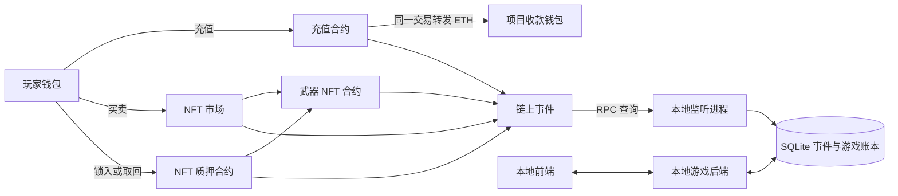
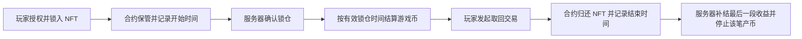

# Forge of Fate · 链上功能与开发计划

更新日期：2026-10-28。

本文说明链上功能做什么、链下服务器怎样配合，以及开发顺序和验收方法。**这是一份开发方案，不表示下列功能已经全部实现。** 本次只更新文档，当前运行能力仍以源码和主 README 的“当前状态”为准。

部署、启动、关闭与补扫操作单独见 [Sepolia 部署与本地服务指南](Sepolia部署与本地服务指南.md)；全部文档入口见[链上文档导航](README.md)。

开发准备已开始：填写方式见[开发前填写清单](开发前填写清单.md)。`.env.sepolia` 与只读检查器已经准备好，当前尚未接入游戏运行和合约部署。

状态标记：**已确定**表示已经确认的业务方向；**建议方案**表示推荐的实现方式；**待定**表示尚未确定的参数或规则；**当前已有**只描述现有源码。

目录：

- [1. 已确定的项目方向](#1-已确定的项目方向)
- [2. 当前代码与目标的差距](#2-当前代码与目标的差距)
- [3. 合约分工、钱包和系统结构](#3-合约分工钱包和系统结构)
- [4. ETH 充值获得游戏币](#4-eth-充值获得游戏币)
- [5. 武器 NFT 与交易市场](#5-武器-nft-与交易市场)
- [6. 抵押 NFT 持续获得游戏币](#6-抵押-nft-持续获得游戏币)
- [7. 服务器监听、补扫和账本](#7-服务器监听补扫和账本)
- [8. 开发顺序与验收](#8-开发顺序与验收)
- [9. 待定事项与维护规则](#9-待定事项与维护规则)

## 1. 已确定的项目方向

按项目负责人确认的课程范围，自主完成一个能够展示 NFT 铸造、实际用途及交易的 DApp。项目继续使用“命运锻造所”的游戏设定、现有技术栈和自定义规则。

| 目标 | 本项目的对应功能 | 验收时展示什么 |
|---|---|---|
| NFT 铸造（页面称“铭刻”） | 达标武器封存后铸造成 ERC-721，保留武器身份与属性 | MetaMask 签名、Sepolia 铸造交易、token ID 与归属 |
| NFT 实际用途 | 锁入质押合约持续获得游戏币，取回后停止产币 | NFT 确实进入合约、奖励按有效区间结算、取回及停产 |
| NFT 交易 | 两个钱包之间挂牌、购买和转移 | ETH 结算、所有权变化、失败条件与交易记录 |
| 游戏经济配套 | 充值获得链下游戏币，再在游戏中消费 | 充值款转入项目钱包，后台一次入账并可恢复 |

以上是本项目对课程宽泛目标的具体落实，不是对外部评分表的逐条转述。NFT 质押是我们选定的用途，充值是游戏配套功能。一个钱包可以拥有和铸造多把不同武器；同一把封存武器在同一部署中只能铸造一次。

| 项目 | 已确定的方向 |
|---|---|
| 演示网络与钱包 | 已确定采用 Ethereum Sepolia 和 MetaMask；Hardhat 仅用于本地开发与测试。 |
| 作业交付 | 由我们完成开发、合约部署和实际操作，提交源码、部署信息、链上交易记录及演示视频。老师重新部署属于可选复现方式，不是主要验收前提。 |
| 服务器运行 | 前端、后端和监听程序在我们的电脑上运行，演示或检查时启动，不使用长期在线的公网后端作为前提。 |
| 停机恢复 | 保存数据库、合约配置和扫描进度；重新启动后连接原合约，补查停机期间的事件。 |
| 游戏币 | 继续采用服务器数据库里的游戏币余额；本阶段不把游戏币做成 ERC-20。充值、质押所得与游戏内消费都进入同一套账本。 |
| ETH 充值 | 玩家调用充值合约，合约核验付款后，在同一笔链上交易中把 ETH 转入我们的项目收款钱包并记录事件。服务器确认后增加游戏币。 |
| 充值提现 | 充值合约不以长期保管充值收入为目的，不设计“管理员定期提取充值款”的步骤。 |
| NFT 交易 | 保留武器 NFT 的铸造、归属和玩家之间的交易功能。市场款项与充值收入分开处理。 |
| NFT 抵押玩法 | NFT 锁定期间持续获得游戏币；取回 NFT 后停止产币；已经获得的游戏币不用归还。 |
| 产币上限 | 累计获得的游戏币暂不设置业务上限。**可抵押 NFT 数量是否限制尚未确定。** |

正式链上演示已确定采用 **Ethereum Sepolia + MetaMask**。本机已配置 Infura 的 Sepolia 节点并通过只读网络检查，确认策略待确定；合约与链上记录保留在 Sepolia，本地服务器按需启动。开发和自动测试继续使用本地 Hardhat。当前游戏源码仍只接通本地链，节点检查通过不等于 Sepolia 部署已经完成。

本文中的 ETH 演示均指目标测试网络上的测试 ETH。游戏币是否允许兑换回 ETH、是否支持充值退款尚未确定，不在本阶段承诺这些能力。

充值采用**付款后发游戏币**，游戏币再按游戏规则消费；游戏币购买武器和材料沿用链下商店。本文与[项目 README](../README.md#项目目标与链上功能)共同维护这一业务方向。

## 2. 当前代码与目标的差距

| 模块 | 当前已有 | 后续需要开发 |
|---|---|---|
| NFT 与市场 | `ForgeOfFate` 同时包含 NFT 铸造、挂牌、撤单、购买、卖家提现和转移 | 评估拆成 NFT 基础合约与独立市场合约；补服务端索引和历史记录 |
| 充值 | 游戏内金币消费已存在 | 独立 ETH 充值合约、订单、事件核验、自动入账和充值页面 |
| NFT 抵押 | 尚无抵押合约和产币账本 | 锁仓、解锁、奖励结算、停止产币、离线恢复 |
| 后端 | FastAPI、SQLite、Web3；按请求查询合约和签发 NFT 铸造授权 | 独立监听进程、扫描进度、事件表、确认处理、游戏币流水 |
| 前端 | 直接查询本地合约，恢复部分待确认交易 | 多合约配置、目标网络配置、订单及索引状态、质押界面 |
| 启动器 | `npm start` 启动本地链、检查部署、启动后端和前端 | 分开“首次部署”和“连接已有公共测试网部署”；管理监听进程与恢复状态 |
| 网络 | 当前仅配置本地 Hardhat，Chain ID 为 `31337` | 公共测试网部署、前后端网络适配、测试账户与环境隔离 |
| 健康检查 | `/api/health` 只返回应用存活状态 | 区分应用存活、节点可用、同步完成和资金处理就绪 |

源码入口：

- [现有合约](../contracts/contracts/ForgeOfFate.sol)
- [现有部署脚本](../contracts/scripts/deploy.cjs)
- [本地启动脚本](../scripts/start.cjs)
- [后端与 SQLite](../backend/app.py)
- [前端链上交互](../frontend/src/App.tsx)
- [当前隔离验证脚本](../scripts/verify-game.cjs)

当前 `npm start`、部署脚本和前端仍包含本地链固定配置。**仅修改 `LOCAL_RPC_URL` 不等于已经支持公共测试网。** 当前程序也不会自动读取 `.env`；后续必须明确配置加载方式，不能把拟定的配置字段当作现成接口。

本目录保存功能计划与部署运行指南。合约源码位于 `contracts/`，后端位于 `backend/`；文档重组不移动业务源码。

## 3. 合约分工、钱包和系统结构

### 3.1 功能边界

建议采用一个 NFT 基础合约，加三个业务合约。以下名称只用于描述职责，正式合约名、接口和事件签名在实现时确定。

| 合约 | 职责 | 持有或处理的资产 |
|---|---|---|
| 武器 NFT 合约 | 铸造、所有权、武器属性、授权和转移 | 记录 NFT 归属 |
| 充值合约 | 验证充值订单、防重复付款、转发 ETH、记录充值事件 | 充值交易中转 ETH，不保留正常充值收入 |
| NFT 市场合约 | 挂牌、撤单、购买、卖家结算 | 买家的成交款属于卖家，项目手续费另按规则处理 |
| NFT 质押合约 | 接收指定 NFT、记录锁仓、允许按规则取回、记录解锁 | 保管玩家锁入的 NFT |

市场和质押合约操作同一批武器 NFT。质押后 NFT 已转入质押合约，玩家不能同时把它卖出或转给别人。市场成交时仍须重新核验当前所有者、授权和挂单条件，不能只相信网页缓存。

### 3.2 钱包、账号和权限

| 身份 | 作用 | 说明 |
|---|---|---|
| 游戏账号 | 保存角色、背包和游戏币 | 需要稳定玩家 ID，不能因切换钱包而误换账本 |
| 玩家钱包 | 支付、持有 NFT、签名证明地址归属 | 绑定应验证签名；前端传来的地址不能直接作为认证结果 |
| 部署钱包 | 签名部署合约并支付部署手续费 | 部署行为本身不自动赋予任意转走合约资产的权限 |
| 项目收款钱包 | 接收充值收入 | 已确定先与部署钱包使用同一地址，在 `PROJECT_WALLET_ADDRESS` 填一次；充值合约部署时指定 |
| 服务器授权签名地址 | 签发 NFT 铸造或充值报价等授权 | 建议与部署、收款钱包分开；监听事件本身不需要私钥 |
| 网站管理员账号 | 如后续需要，用来查看订单和运行状态 | 是否制作管理页面待定；网站角色不会自动变成合约管理权限 |

建议首版固定充值收款地址，修改收款地址通过新部署明确切换；若以后加入修改接口，再单独确定管理权限。用户不需要把助记词或私钥交给网站。链上授权应由合约验证，不能只靠隐藏前端按钮。

## 4. ETH 充值获得游戏币

### 4.1 已确定的资金流程

**玩家付款 → 充值合约核验 → ETH 转入项目钱包并记录事件 → 服务器等待确认 → 增加游戏币。**

合约收款和转发属于同一笔链上交易；游戏数据库入账属于后续处理。这两部分不能假设为跨链上、数据库的一次原子提交，因此必须保留订单和重试状态。

### 4.2 建议的完整步骤

1. 玩家登录游戏，验证并绑定付款钱包，选择充值档位或输入允许的充值金额。
2. 后端按当前价格规则创建唯一订单，固定玩家 ID、付款钱包、ETH 金额、游戏币数量、网络、合约和到期时间。订单先持久化，再向玩家提供付款授权。
3. 建议采用服务器签名报价，合约验证报价签名；具体充值档位、兑换比例和有效期待定。客户端不能自己填写一个游戏币数量并要求服务器照发。
4. 玩家调用指定充值方法并支付 ETH，钱包显示目标网络、目标合约及金额。不要引导玩家用普通转账代替这个方法。
5. 合约核验授权、付款人、金额、到期时间和订单是否已经付款。建议先标记订单已付款，再进行受重入保护的资金转发。
6. 合约把本次付款转给配置的项目收款钱包。转发失败应使整笔充值回滚，包括已付款标记；不得保留一个看似成功的充值结果。
7. 成功后记录充值事件，至少能够关联订单、付款钱包、ETH 金额和游戏币数量。前端展示交易哈希和“链上确认中”。
8. 监听程序通过节点独立核验网络、合约、成功回执、事件和订单一致性，达到选定确认条件后处理入账。
9. 在同一次数据库事务中写入游戏币流水、增加余额、标记订单已入账。重复事件、重复提交交易哈希、服务重启均不得再次增加余额。
10. 前端查询订单，显示“充值完成”。浏览器关闭不影响服务器后续处理。

签名报价建议使用 EIP-712，并绑定链 ID、验证合约、部署版本、唯一订单号、付款人、金额、游戏币数量和到期时间。**EIP-712 本身不提供业务防重放；订单消费标记、用途隔离和有效期需要我们实现。** 参考 [EIP-712](https://eips.ethereum.org/EIPS/eip-712)。账号映射保存在本地订单中，链上不公开用户名或登录信息。

### 4.3 状态与异常处理

| 情况 | 处理 |
|---|---|
| 尚未付款 | 保持待付款，可在有效期内提交 |
| 已提交但尚未打包 | 展示等待，不增加游戏币 |
| 已打包、确认不足 | 展示确认中，不把待确认金额当作可消费余额 |
| 已确认、后台未入账 | 保留待入账任务，自动重试 |
| 入账成功 | 保留永久订单与流水，重复处理返回原结果 |
| 拒签或单笔交易失败 | 不增加游戏币；订单若仍有效且链上未付款，可以重试，不把一次失败永久等同于订单作废 |
| 后台关闭时付款成功 | 重新启动后补扫，再入账；关闭期间不能创建需要后台新签名的订单 |
| 扫描时报价已经过期，但交易在有效期内成功 | 根据链上成功执行和原订单核验，不能因为后台处理较晚而拒绝入账 |
| 找到事件但本地订单缺失 | 保留待核对记录，暂停该笔自动入账，不猜测收款账号，也不丢弃事件 |
| 地址收到普通 ETH 转账，但没有有效充值事件 | 不自动增加游戏币；首版建议拒绝普通直接转账入口 |

充值金额使用 wei 整数，游戏币使用统一的整数单位，不使用浮点数处理金额。价格变更不改写已经签发订单的数量；旧订单在其有效期内按原报价处理。

此方案不包含充值退款和游戏币兑回 ETH。项目钱包收到款后，充值合约不能凭空从该钱包扣回资金；若增加资金返还，需另行设计。

## 5. 武器 NFT 与交易市场

### 5.1 当前已有的流程

当前游戏中的普通强化在后端结算。武器达到现行门槛、永久封存后，后端签发铸造授权，玩家提交链上交易铸造 NFT。NFT 等级和元数据在铸造后固定。

当前 `ForgeOfFate` 已记录 `Forged`、`Listed`、`Unlisted`、`Purchased`，并通过 ERC-721 记录 `Transfer`。监听服务需要覆盖直接转移，不能只处理从我们页面发起的交易。

当前市场使用测试 ETH 成交：买家付款与 NFT 转移在同一笔交易完成，成交款记入卖家可提取收益，由卖家调用提现方法领取。**充值收入直接转入项目钱包的决定，不会自动修改市场的卖家结算方式。**

### 5.2 后续实现要求

- 将 NFT 的归属、挂牌状态和历史事件同步到本地可查询记录，前端显示同步状态。
- 拆分合约时保留买家预期卖家、预期价格校验，防止按已经变化的挂单条件成交。
- NFT 已质押或转走时，旧挂单不能继续成交；独立市场合约需要处理挂单失效及展示清理。
- 抵押与市场都只按已明确接受的 NFT 集合工作，不默认接收任意外部 NFT。
- 首版沿用 ETH 买卖方向；游戏币购买 NFT、市场手续费和是否改为即时转付卖家，均待另行确定。

ERC-721 的授权、转移和安全接收接口可参考 [OpenZeppelin ERC-721 文档](https://docs.openzeppelin.com/contracts/5.x/api/token/erc721)。

## 6. 抵押 NFT 持续获得游戏币

### 6.1 已确定的玩法

页面可以使用“抵押”一词，开发中按**质押产币**设计：

- NFT 锁入合约期间持续获得游戏币。
- 玩家取回 NFT 后，该笔锁仓停止继续产币。
- 已获得的游戏币不用归还，不设置还币才能赎回的借款流程。
- 累计产币暂不封顶，不设置累计奖励上限或到额停产规则。
- 每把 NFT 的产币速度、是否随等级变化、最短锁定时间、可抵押数量限制仍待确定。

### 6.2 建议的锁仓流程

1. 玩家登录并绑定钱包，选择自己持有且符合规则的 NFT。
2. 页面展示产币规则、取回条件及交易费用。玩家授权质押合约转移指定 NFT。
3. 玩家调用锁仓方法。合约检查 NFT 集合、当前所有者、授权和该 NFT 是否已处于有效锁仓中。
4. 合约把 NFT 转入自身保管，为这次锁仓生成唯一 `positionId`，记录原持有人、NFT 地址、token ID、开始时间及适用规则版本，并发出锁仓事件。
5. 服务器在事件达到确认条件后，建立与玩家账号关联的产币记录，开始按规则结算。

每次重新锁入都生成新的一笔记录。不能只用 token ID 去重，否则同一把 NFT 再次质押时会混淆旧收益。

通过锁仓方法接收 NFT，校验接收回调与预期资产，避免把直接转入但没有锁仓记录的 NFT 自动认作有效质押。误转资产的恢复规则另行确定。

### 6.3 建议的产币与取回流程

建议以**链上时间和已确认的锁仓区间**计算产币，不依赖网页是否打开，也不靠服务器内存里的计时器累加。收益在本地账本中结算，玩家不需要为每次增加游戏币发送链上交易。

建议取回由锁仓持有人直接调用合约，合约检查取回条件后归还 NFT，服务器根据解锁事件结算最后一段收益。**既然不需要归还游戏币，首版不需要由服务器签发“已还款赎回授权”。** 这样后台关闭期间，持有人仍可通过合约接口取回符合条件的 NFT；本地游戏页面关闭时不代表有另一个公开页面可用。

锁仓与取回需要防止重入。取回时先更新锁仓状态，再安全转移 NFT；如果资产转移失败，整笔交易回滚，锁仓仍然有效。合约按锁仓记录验证取回人，网站管理员身份不能替代这个检查。

建议公式：

> 本次应结算收益 = 从上次结算边界到本次确认边界之间，处于有效锁仓状态的时长 × 该笔锁仓适用的产币速率。

最终收益截止到链上取回交易的时间，而不是后台发现这笔交易的时间。具体单位和取整方式待定；实现时使用整数或有理数累计并保留余数，避免玩家频繁刷新、结算或重启改变总收益。

建议每笔锁仓固定规则版本，调价默认只影响后续新锁仓。规则版本应可追溯，不能后台修改一个配置就悄悄改变过去已经产生的收益。是否采用这一方式待确定。

### 6.4 停机期间的奖励：建议规则，尚待确认

建议**后台关闭不影响链上有效锁仓时间的累计，重启后补算**。这是实现建议，目前不把它当作已经确认的业务规则。

例如：10:00 锁入，10:20 后台关闭，11:00 在链上取回，12:00 后台恢复。按此建议，应只结算 10:00～11:00 的有效锁仓区间；不能漏算停机期间，也不能继续发放到 12:00。例子只说明时间边界，不预设具体产币数量。

恢复时必须**先补齐锁仓、解锁等事件，再结算收益**。不能先把数据库里的“仍在质押”记录一律算到当前时间，再去发现早已解锁。

| 场景 | 应有处理 |
|---|---|
| 取回交易提交但没有成功执行 | NFT 仍锁在链上，是否继续产币按有效锁仓规则计算 |
| 取回成功、后台暂时关闭 | 保留链上结束时间；重启后只补结到该时间 |
| 取回后再次锁入 | 建立新锁仓区间；两次锁仓之间不产币 |
| 多次扫描或重复结算 | 只增加尚未结算的收益，结算边界和余额一起提交 |
| 锁仓和解锁都发生在停机期间 | 补扫完整区间后结算，不能只检查 NFT 当前是否仍在合约里 |
| 未找到对应游戏账号 | 保存待关联记录；验证钱包归属后再处理，不能凭客户端声明发币 |

不封顶是业务规则，不代表一次查询必须加载全部记录。批量扫描、分页和分段结算可以控制处理量，但不能因此截断玩家应得奖励。

## 7. 服务器监听、补扫和账本

### 7.1 监听方式

建议新增独立的 Python 监听进程，与 FastAPI 共用业务模块和 SQLite 数据库。首版只运行一个负责同一环境的索引实例，避免 API 自动重载或多个 worker 重复启动监听器。

按区块范围调用 `eth_getLogs`，限定允许的合约地址和事件；从部署区块开始，按区块号、交易顺序、日志序号处理。查询范围分批，超时或节点限制时缩小批次并重试，失败不跳过该区间。接口定义见 [以太坊 JSON-RPC 文档](https://ethereum.org/developers/docs/apis/json-rpc/#eth_getlogs)。

WebSocket 可作为后续的及时通知手段，但不能代替补扫。订阅不补发历史事件，连接关闭后需要重新订阅，详见 [Geth 订阅说明](https://geth.ethereum.org/docs/interacting-with-geth/rpc/pubsub)。

### 7.2 建议保存的数据

以下为拟定的数据职责，不表示这些表已经存在；正式字段通过版本化迁移建立。

| 数据 | 主要内容 |
|---|---|
| 部署配置 | 环境标识、链 ID、合约地址、部署区块、部署交易、ABI/版本、收款地址、授权签名地址 |
| 扫描进度 | 每个扫描范围完整保存到的区块号和哈希、确认边界、最近成功时间；无匹配事件的区块也要能推进进度 |
| 链上事件 | 合约、区块号和哈希、交易哈希、日志序号、事件内容、确认/作废状态、业务处理状态 |
| 充值订单 | 稳定玩家 ID、绑定钱包、报价内容、订单号、付款证据、入账状态 |
| 游戏币流水 | 玩家、增减金额、业务来源、来源唯一标识、余额变更；质押另保存已结算边界和余数 |
| NFT 索引 | NFT 当前归属、挂牌状态、铸造与交易历史；应能由有效链上记录重建 |
| 质押记录 | 锁仓编号、持有人、NFT、开始/结束时间、规则版本、收益结算进度 |

事件身份须包含网络/部署范围、合约、区块哈希和日志序号，保留交易哈希用于追踪；同一交易在重组后重新打包时不能简单当成旧日志忽略。充值等业务还要按**订单号**做独立唯一约束，不能只靠交易哈希避免重复入账。

### 7.3 两种进度不能混淆

- **扫描进度**：这段区块中的全部目标事件已可靠保存。事件写入与扫描进度推进在同一次事务提交；异常则都不提交。
- **业务进度**：某笔事件已完成入账或同步。事件可以先入库，稍后重试业务处理；扫描已经前进，不代表所有订单都已经完成。

充值的订单完成标记、游戏币流水和余额变更必须原子提交。质押奖励的结算边界、余数、流水和余额也必须原子提交。重复处理依靠唯一约束返回原结果，不能只在内存里记录“处理过”。

默认从已保存边界之后继续补扫，并重查仍可能变化的近期区块。区块请求失败不能被当成“本区间没有事件”。链 ID、部署标识或区块哈希对不上时，应停下相关处理并定位原因，不自动清库或自动换新部署。

### 7.4 确认和链重组

新打包不等于最终确定。围绕已确定的 Sepolia 网络明确采用的最终性标记或确认策略，并分别显示“已发现”“确认中”“已处理”。确认数量不能未经说明照搬其他链的数值。

首版建议只把达到结算确认条件的充值和奖励变为可消费余额，质押结算不能越过已经完整扫描的确认边界。保存区块哈希和近期历史，检查链重组；发现孤立事件，先作废待处理记录并从共同有效边界重扫。

如果重组影响已经入账且可能消费的资金，暂停受影响的发放和消费，保留证据并执行明确的冲正/补偿流程；不能简单删事件或静默扣成负数。处理策略及边界需要在启用公共测试网资金流程前验收。

### 7.5 运行状态

页面或日志至少可看到：目标链与合约、节点最新高度、已扫描高度、可结算确认高度、最近成功扫描时间、待处理订单数量、失败原因、质押收益结算进度。

应用存活不代表资金模块就绪。启动补扫时允许看同步进度；涉及余额变化或质押收益的操作，需要等对应数据同步完成。后台不可用时，前端显示“等待服务器处理”，不能把数据库尚未入账描述为已经到账。

## 8. 开发顺序与验收

先完成可核查的 Sepolia NFT 基础流程，再完善配套充值和 NFT 用途。每完成一阶段，更新实际源码入口、命令和验证结果。下列均为后续任务，不是本轮已经执行的检查。

### 阶段一：环境、钱包与公共数据基础

- [x] 提供本地 Sepolia 配置模板、填写说明和只读检查命令；项目钱包同时用于部署和收款。本机已填写项目钱包、RPC 和第二个演示钱包；2026-10-28 格式与真实 RPC 检查通过，返回 Ethereum Sepolia（11155111）。未检查钱包控制权、余额或合约部署，未发送交易。
- [ ] 在既定 Sepolia 目标下确定 RPC、确认策略和部署清单格式。
- [ ] 统一前后端网络配置，支持 MetaMask 切换与检查目标链，区分首次部署和日常启动。
- [ ] 确定账号与钱包映射，给订单和账本使用稳定玩家 ID。
- [ ] 建立版本化迁移、链上事件、扫描进度、游戏币流水和环境隔离。
- [ ] 用现有 NFT 事件验证扫描、重复处理、重启补扫和健康状态。

验收：连接错误环境能识别；重复读取不重复处理；后端关闭后发生的 NFT 转移，在重启后能被补查。

### 阶段二：Sepolia 上的 NFT 铸造与交易

- [ ] 确定是否拆分现有 NFT/市场合约及最终的卖家结算方式。
- [ ] 在 Sepolia 部署这一阶段已经完成的合约，保存地址、部署交易、源码版本和编译设置，并完成源码验证。
- [ ] 用 MetaMask 完成封存武器铸造、双钱包挂牌购买、撤单、转移和卖家收款。
- [ ] 完成 NFT 归属、挂牌和交易历史索引，前端提供完整交易哈希及区块浏览器链接。
- [ ] 验证拒签、账户/网络切换、价格变化、授权撤销、交易替换、NFT 已转移和旧挂单失效。
- [ ] 验证关闭本地服务器后，重新启动继续使用原 Sepolia 部署。

验收：NFT 确实铸造到玩家钱包；成交后归属与卖家资金记录一致，操作可在区块浏览器核查。此阶段已展示铸造和交易，质押用途在阶段四完成。

### 阶段三：充值闭环

- [ ] 确定充值档位/报价、有效期和项目收款地址。
- [ ] 实现订单签发、充值合约、即时转发 ETH 和充值事件，在 Sepolia 演示环境增加这份部署。
- [ ] 实现确认后原子入账、订单查询和前端状态。
- [ ] 验证金额/钱包不匹配、过期报价、重复订单、跨链/跨合约重放、收款转发失败。
- [ ] 验证关网页、停机补入账、入账事务中断、交易替换及链重组处理。

验收：成功充值的 ETH 到达项目钱包，普通充值不会积存在合约里；一笔有效订单只增加一次游戏币；链上成功但后台暂未处理的订单可恢复。

### 阶段四：NFT 质押产币与取回

- [ ] 确定产币速度、规则版本、离线是否累计、取回条件及可质押数量规则。
- [ ] 实现锁仓、持有人取回、开始/结束事件和每次锁仓唯一编号，在 Sepolia 演示环境增加质押合约。
- [ ] 实现分段收益结算、余数保留、已结算边界和游戏币流水。
- [ ] 实现取回后的最后一段结算，且已获得的币不需要归还。
- [ ] 验证重复质押、重复结算、频繁结算、二次锁仓、转移中的回调和异常退出。
- [ ] 验证整个锁仓区间发生在停机期间、取回后停产、无累计产币上限和重组处理。
- [ ] 验证同一 NFT 在市场和质押间流转时的所有权与挂单状态。

验收：NFT 具有实际用途；应得收益只记一次，取回后不继续计算新的收益；重复启动或重复扫描不改变最终应得总额。

### 阶段五：完整录制与交付

- [ ] 连贯录制 NFT 铸造、双钱包交易、充值、质押产币、取回停产和服务器恢复。
- [ ] 保存源码版本、部署清单、链上交易和演示步骤；视频不显示私钥或访问凭据。
- [ ] 更新本计划、部署运行指南与主 README 的当前状态、真实命令和已完成事项。
- [ ] 按实际链路补齐 `.env.sepolia.example` 和逐项填写说明，在独立测试目录验证从模板配置、部署与启停；将空白模板随源码提交 GitHub，真实 `.env.sepolia` 留在本机。后续配置字段变更时同步维护模板。
- [ ] 提交源码、依赖锁文件、部署脚本、公开部署清单、视频及操作记录。

验收：通过演示视频与链上证据可以核查我们完成的功能；源码和部署流程支持有需要时复现，无需老师先自行部署才能查看成果。提交形式为本项目准备方案，若课程另给材料清单，再补齐具体格式。

## 9. 待定事项与维护规则

### 待讨论的业务参数

| 事项 | 当前状态 |
|---|---|
| 目标测试网与钱包 | 已确定：Ethereum Sepolia + MetaMask |
| RPC 服务与确认策略 | 本机已配置 Infura Ethereum Sepolia，并通过只读网络检查；确认策略待定 |
| 项目收款地址 | 已确定与部署钱包相同，本机已填写 `.env.sepolia` 的 `PROJECT_WALLET_ADDRESS`；具体值不复制到公开模板 |
| 固定收款地址是否允许变更 | 建议首版固定，最终实现待定 |
| 充值兑换比例、档位、最小金额、报价有效期 | 待定 |
| 充值退款、游戏币兑回 ETH | 未确定，本阶段不默认实现 |
| 质押产币速率、NFT 等级与收益关系 | 待定 |
| 质押累计奖励上限 | 已确定：暂不封顶 |
| 可质押 NFT 数量限制 | 待定，不能将累计奖励不封顶解释为数量也不限 |
| 最短锁仓时间、取回费用和其他取回条件 | 待定；不默认加入罚金或费用 |
| 后台关闭期间是否继续累计质押收益 | 建议按链上有效锁仓时间累计，待确认 |
| 质押收益到账频率、精度和余数规则 | 待定 |
| 收益规则调整是否仅影响新锁仓 | 建议如此，待确认 |
| NFT 市场手续费、合约拆分和卖家结算 | 待定；当前已有卖家自行提现 |
| 管理员页面 | 待定，不是完成充值收款的前提 |

每次开始开发前先核对本文件对应阶段；业务决策变化时更新“已确定”和“待定”，不能把建议参数直接写成已确认需求。实现完成后补上真实接口、命令、合约地址所在文件和验证结果，保留计划与当前实现的区别。

文档中的事件名、表名、配置分类和流程均服务于讨论与实现；没有列出的具体地址、价格、产币数量和确认数，不应自行填成正式配置。
