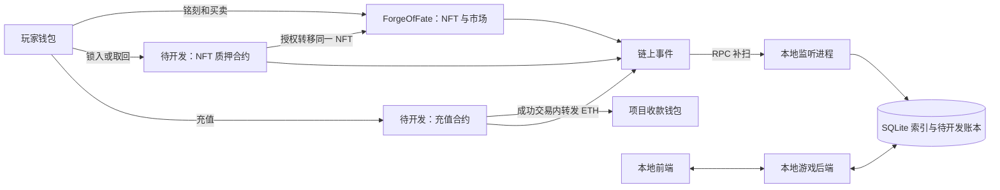
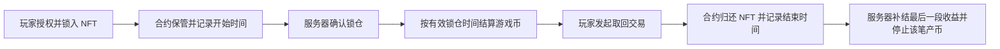

# Forge of Fate · 链上功能与开发计划

更新日期：2026-10-28。

本文说明链上功能做什么、链下服务器怎样配合，以及开发顺序和验收方法。**这是一份开发方案，不表示下列功能已经全部实现。** 开发已开始，当前运行能力以源码及[链上实施状态总览](README.md)的证据表为准；本次文档核对不代表新增业务实现。

部署、启动、关闭与补扫操作单独见 [Sepolia 部署与本地服务指南](Sepolia部署与本地服务指南.md)；全部文档入口见[链上文档导航](README.md)。

日常运行已使用 Sepolia，通用 MetaMask 部署工作台已实现，当前仅提供无业务验证合约。填写方式见[开发前填写清单](开发前填写清单.md)。已实现配置检查、前后端网络适配、隔离的 Sepolia 后端入口，以及页面 / 接口 / 数据库一致性回归。已实现独立 NFT 监听、确认历史、停机补扫和同步面板，详见[链上监听与恢复](链上监听与恢复.md)。本机只有 Probe 部署计划，没有保存其交易状态或成功记录，Sepolia NFT 业务清单和铸造授权密钥也不存在；NFT 业务部署接入、充值、质押和游戏币流水待继续开发。三张成品图已从公开仓库接入固定版本地址，各部署共用；图片映射与验收状态见[图片说明](../assets/NFT_Pic/README.md)。测试优先在本地完成，方法见[本地测试指南](本地测试与页面数据一致性.md)。

状态标记：**已确定**表示已经确认的业务方向；**建议方案**表示推荐的实现方式；**待定**表示尚未确定的参数或规则；**当前已有**只描述现有源码。

目录：

- [1. 已确定的项目方向](#1-已确定的项目方向)
- [2. 当前代码与目标的差距](#2-当前代码与目标的差距)
- [3. 合约分工、钱包和系统结构](#3-合约分工钱包和系统结构)
- [4. ETH 充值获得游戏币](#4-eth-充值获得游戏币)
- [5. 武器 NFT 与交易市场](#5-武器-nft-与交易市场)
- [6. 抵押 NFT 持续获得游戏币](#6-抵押-nft-持续获得游戏币)
- [7. 服务器监听、补扫和账本](#7-服务器监听补扫和账本)
- [8. 开发顺序与验收](#8-开发顺序与验收)
- [9. 待定事项与维护规则](#9-待定事项与维护规则)

## 1. 已确定的项目方向

按项目负责人确认的课程范围，自主完成一个能够展示 NFT 铸造、实际用途及交易的 DApp。项目继续使用“命运锻造所”的游戏设定、现有技术栈和自定义规则。

| 目标 | 本项目的对应功能 | 验收时展示什么 |
|---|---|---|
| NFT 铸造（页面称“铭刻”） | 达标武器封存后铸造成 ERC-721，保留武器身份与属性 | MetaMask 签名、Sepolia 铸造交易、token ID 与归属 |
| NFT 实际用途 | 锁入质押合约持续获得游戏币，取回后停止产币 | NFT 确实进入合约、奖励按有效区间结算、取回及停产 |
| NFT 交易 | 两个钱包之间挂牌、购买和转移 | ETH 结算、所有权变化、失败条件与交易记录 |
| 游戏经济配套 | 充值获得链下游戏币，再在游戏中消费 | 充值款转入项目钱包，后台一次入账并可恢复 |

以上是本项目对课程宽泛目标的具体落实，不是对外部评分表的逐条转述。NFT 质押是我们选定的用途，充值是游戏配套功能。一个钱包可以拥有和铸造多把不同武器；同一把封存武器在同一部署中只能铸造一次。

| 项目 | 已确定的方向 |
|---|---|
| 演示网络与钱包 | 已确定采用 Ethereum Sepolia 和 MetaMask；Hardhat 仅用于本地开发与测试。 |
| 作业交付 | 由我们完成开发、合约部署和实际操作，提交源码、部署信息、链上交易记录及演示视频。老师重新部署属于可选复现方式，不是主要验收前提。 |
| 服务器运行 | 前端、后端和监听程序在我们的电脑上运行，演示或检查时启动，不使用长期在线的公网后端作为前提。 |
| 停机恢复 | 保存数据库、合约配置和扫描进度；重新启动后连接原合约，补查停机期间的事件。 |
| 游戏币 | 继续采用服务器数据库里的游戏币余额；本阶段不把游戏币做成 ERC-20。充值、质押所得与游戏内消费都进入同一套账本。 |
| ETH 充值 | 玩家调用充值合约，合约核验付款后，在同一笔链上交易中把 ETH 转入我们的项目收款钱包并记录事件。服务器确认后增加游戏币。 |
| 充值提现 | 充值合约不以长期保管充值收入为目的，不设计“管理员定期提取充值款”的步骤。 |
| NFT 图片 | 所有部署复用项目固定公开图片链接；GitHub 来源优先锁定提交版本。公共映射随源码提交，老师无需重新上传；实际访问状态与接入进度见[图片说明](../assets/NFT_Pic/README.md)。 |
| NFT 交易 | 保留武器 NFT 的铸造、归属和玩家之间的交易功能。市场款项与充值收入分开处理。 |
| NFT 抵押玩法 | NFT 锁定期间持续获得游戏币；取回 NFT 后停止产币；已经获得的游戏币不用归还。 |
| 产币上限 | 累计获得的游戏币暂不设置业务上限。**可抵押 NFT 数量是否限制尚未确定。** |

正式链上演示已确定采用 **Ethereum Sepolia + MetaMask**。本机已配置 Infura 的 Sepolia 节点并通过只读网络检查；确认历史采用 finalized 边界，节点能力已只读验证；合约与链上记录保留在 Sepolia，本地服务器按需启动。开发和自动测试继续使用本地 Hardhat。已实现网络适配，但完整交易仍仅在本地链验收，节点检查通过不等于 Sepolia 部署已经完成。

本文中的 ETH 演示均指目标测试网络上的测试 ETH。游戏币是否允许兑换回 ETH、是否支持充值退款尚未确定，不在本阶段承诺这些能力。

充值采用**付款后发游戏币**，游戏币再按游戏规则消费；游戏币购买武器和材料沿用链下商店。本文与[项目 README](../README.md#项目目标与链上功能)共同维护这一业务方向。

## 2. 当前代码与目标的差距

| 模块 | 当前已有 | 后续需要开发 |
|---|---|---|
| NFT 与市场 | `ForgeOfFate` 同时包含 NFT 铸造、挂牌、撤单、购买、卖家提现和转移 | 图片、索引与确认历史已完成；补 NFT 部署模块、该环境授权密钥和业务清单，统一交易确认状态，再做 Sepolia 验收；建议首版保留合并结构 |
| NFT 图片 | 三张公开成品图已接入固定版本映射，保留每把武器独立属性；游戏卡片继续使用 23 张透明图 | Sepolia 业务部署后核对真实钱包展示 |
| 充值 | 游戏内金币消费已存在 | 独立 ETH 充值合约、订单、事件核验、自动入账和充值页面 |
| NFT 抵押 | 尚无抵押合约和产币账本 | 锁仓、解锁、奖励结算、停止产币、离线恢复 |
| 后端 | FastAPI、SQLite、Web3；独立 NFT 监听、确认历史、扫描进度、停机恢复和同步状态 | 稳定玩家 ID、充值订单、游戏币流水、质押结算 |
| 前端 | 按后端公开网络配置连接钱包，NFT / 回执经只读接口查询；请求顺序、会话变化与失败重试有保护 | 多合约配置、订单及索引状态、质押界面、MetaMask 人工联调 |
| 启动器 | `npm start` 启动 Sepolia 游戏服务，部署工作台另行启动并恢复原计划 | 继续接入后续业务合约与完整账本恢复 |
| 网络 | 前后端支持 local / sepolia 配置；Sepolia 后端使用独立目录，数据库拒绝跨网络复用 | 公共测试网部署、签名密钥与完整部署身份绑定、真实钱包验收 |
| 游戏交易确认 | 当前回执成功即提示成功；市场读最新块；NFT 确认历史另等 finalized | 区分已打包、最终确认和索引完成，补 NFT 页面交易替换/取消/重启恢复，不能直接复用到发币 |
| 健康检查 | `/api/health` 检查应用存活，`/api/chain/status` 提供节点与同步状态，`fundingReady` 固定为 false | 接入充值与质押后实现资金处理就绪判断 |

源码入口：

- [现有合约](../contracts/contracts/ForgeOfFate.sol)
- [Sepolia 部署工作台启动器](../scripts/deploy-console.cjs)
- [旧本地 NFT 部署脚本](../contracts/scripts/deploy.cjs)
- [日常 Sepolia 游戏启动器](../scripts/start.cjs)
- [后端与 SQLite](../backend/app.py)
- [前端链上交互](../frontend/src/App.tsx)
- [当前隔离验证脚本](../scripts/verify-game.cjs)

`npm start` 与 `npm run deploy` 已统一使用 Sepolia。前端已移除固定的读取节点与链 ID，后端公开配置提供目标网络；私密 RPC 保留在服务器。`npm run backend:sepolia` 明确读取 `.env.sepolia` 并选择 `.local/sepolia/`，不会自动部署。NFT 业务部署清单版本 2 仍对应单个 `ForgeOfFate`，已补部署交易、区块、创世与代码哈希；NFT 事件索引和停机补扫已实现。通用 Sepolia 部署入口已实现，其验证合约记录保存在独立目录，不能当作 NFT 清单。多业务合约、资金恢复与真实业务部署仍待实现。

本目录保存功能计划与部署运行指南。合约源码位于 `contracts/`，后端位于 `backend/`；文档重组不移动业务源码。

## 3. 合约分工、钱包和系统结构

### 3.1 功能边界

当前 `ForgeOfFate` 已合并 NFT 与市场。**首版建议保留合并结构，另加质押和充值合约**，先利用已验证的路径完成 Sepolia；这是一项实现建议，正式业务部署前确定，不改写成已经确认的合约拆分要求。下表按职责划分，NFT 与市场两行不代表必须部署两份合约；如果未来拆分市场，需要另做 NFT 授权、挂单失效处理和回归。

| 合约 | 职责 | 持有或处理的资产 |
|---|---|---|
| 武器 NFT 合约 | 铸造、所有权、武器属性、授权和转移 | 记录 NFT 归属 |
| 充值合约 | 验证充值订单、防重复付款、转发 ETH、记录充值事件 | 充值交易中转 ETH，不保留正常充值收入 |
| NFT 市场合约 | 挂牌、撤单、购买、卖家结算 | 买家的成交款属于卖家，项目手续费另按规则处理 |
| NFT 质押合约 | 接收指定 NFT、记录锁仓、允许按规则取回、记录解锁 | 保管玩家锁入的 NFT |

市场和质押合约操作同一批武器 NFT。质押后 NFT 已转入质押合约，玩家不能同时把它卖出或转给别人。市场成交时仍须重新核验当前所有者、授权和挂单条件，不能只相信网页缓存。

拓展目标如下：`ForgeOfFate` 已有本地验证，充值和质押方框仍待实现。

### 3.2 钱包、账号和权限

| 身份 | 作用 | 说明 |
|---|---|---|
| 游戏账号 | 保存角色、背包和游戏币 | 需要稳定玩家 ID，不能因切换钱包而误换账本 |
| 玩家钱包 | 支付、持有 NFT、签名证明地址归属 | 绑定应验证签名；前端传来的地址不能直接作为认证结果 |
| 部署钱包 | 签名部署合约并支付部署手续费 | 部署行为本身不自动赋予任意转走合约资产的权限 |
| 项目收款钱包 | 接收充值收入 | 已确定先与部署钱包使用同一地址，在 `PROJECT_WALLET_ADDRESS` 填一次；充值合约部署时指定 |
| 服务器授权签名地址 | 签发 NFT 铸造或充值报价等授权 | 建议与部署、收款钱包分开；监听事件本身不需要私钥 |
| 网站管理员账号 | 如后续需要，用来查看订单和运行状态 | 是否制作管理页面待定；网站角色不会自动变成合约管理权限 |

建议首版固定充值收款地址，修改收款地址通过新部署明确切换；若以后加入修改接口，再单独确定管理权限。用户不需要把助记词或私钥交给网站。链上授权应由合约验证，不能只靠隐藏前端按钮。

## 4. ETH 充值获得游戏币

### 4.1 已确定的资金流程

**玩家付款 → 充值合约核验 → ETH 转入项目钱包并记录事件 → 服务器等待确认 → 增加游戏币。**

合约收款和转发属于同一笔链上交易；游戏数据库入账属于后续处理。这两部分不能假设为跨链上、数据库的一次原子提交，因此必须保留订单和重试状态。

### 4.2 建议的完整步骤

1. 玩家登录游戏，验证并绑定付款钱包，选择充值档位或输入允许的充值金额。
2. 后端按当前价格规则创建唯一订单，固定玩家 ID、付款钱包、ETH 金额、游戏币数量、网络、合约和到期时间。订单先持久化，再向玩家提供付款授权。
3. 建议采用服务器签名报价，合约验证报价签名；具体充值档位、兑换比例和有效期待定。客户端不能自己填写一个游戏币数量并要求服务器照发。
4. 玩家调用指定充值方法并支付 ETH，钱包显示目标网络、目标合约及金额。不要引导玩家用普通转账代替这个方法。
5. 合约核验授权、付款人、金额、到期时间和订单是否已经付款。建议先标记订单已付款，再进行受重入保护的资金转发。
6. 合约把本次付款转给配置的项目收款钱包。转发失败应使整笔充值回滚，包括已付款标记；不得保留一个看似成功的充值结果。
7. 成功后记录充值事件，至少能够关联订单、付款钱包、ETH 金额和游戏币数量。前端展示交易哈希和“链上确认中”。
8. 监听程序通过节点独立核验网络、合约、成功回执、事件和订单一致性，达到选定确认条件后处理入账。
9. 在同一次数据库事务中写入游戏币流水、增加余额、标记订单已入账。重复事件、重复提交交易哈希、服务重启均不得再次增加余额。
10. 前端查询订单，显示“充值完成”。浏览器关闭不影响服务器后续处理。

签名报价建议使用 EIP-712，并绑定链 ID、验证合约、部署版本、唯一订单号、付款人、金额、游戏币数量和到期时间。**EIP-712 本身不提供业务防重放；订单消费标记、用途隔离和有效期需要我们实现。** 参考 [EIP-712](https://eips.ethereum.org/EIPS/eip-712)。账号映射保存在本地订单中，链上不公开用户名或登录信息。

### 4.3 状态与异常处理

| 情况 | 处理 |
|---|---|
| 尚未付款 | 保持待付款，可在有效期内提交 |
| 已提交但尚未打包 | 展示等待，不增加游戏币 |
| 已打包、确认不足 | 展示确认中，不把待确认金额当作可消费余额 |
| 已确认、后台未入账 | 保留待入账任务，自动重试 |
| 入账成功 | 保留永久订单与流水，重复处理返回原结果 |
| 拒签或单笔交易失败 | 不增加游戏币；订单若仍有效且链上未付款，可以重试，不把一次失败永久等同于订单作废 |
| 后台关闭时付款成功 | 重新启动后补扫，再入账；关闭期间不能创建需要后台新签名的订单 |
| 扫描时报价已经过期，但交易在有效期内成功 | 根据链上成功执行和原订单核验，不能因为后台处理较晚而拒绝入账 |
| 找到事件但本地订单缺失 | 保留待核对记录，暂停该笔自动入账，不猜测收款账号，也不丢弃事件 |
| 地址收到普通 ETH 转账，但没有有效充值事件 | 不自动增加游戏币；首版建议拒绝普通直接转账入口 |

充值金额使用 wei 整数，游戏币使用统一的整数单位，不使用浮点数处理金额。价格变更不改写已经签发订单的数量；旧订单在其有效期内按原报价处理。

此方案不包含充值退款和游戏币兑回 ETH。项目钱包收到款后，充值合约不能凭空从该钱包扣回资金；若增加资金返还，需另行设计。

## 5. 武器 NFT 与交易市场

### 5.1 当前已有的流程

以下 NFT 流程指已在隔离测试链验证的既有代码；日常 Sepolia 尚无对应业务部署。普通强化在后端结算。武器达到现行门槛、永久封存后，后端签发铸造授权，玩家提交链上交易铸造 NFT。NFT 等级和元数据在铸造后固定。

当前 `ForgeOfFate` 已记录 `Forged`、`Listed`、`Unlisted`、`Purchased`，并通过 ERC-721 记录 `Transfer`。监听服务需要覆盖直接转移，不能只处理从我们页面发起的交易。

当前市场使用测试 ETH 成交：买家付款与 NFT 转移在同一笔交易完成，成交款记入卖家可提取收益，由卖家调用提现方法领取。**充值收入直接转入项目钱包的决定，不会自动修改市场的卖家结算方式。**

### 5.2 固定图片与元数据

已接入我们提供的公开图片仓库 `ssy1245/NFT_image`，所有复现环境共用，不要求老师上传图片。Raw 地址固定到提交版本，URL 与武器路线对应关系保存在[公共配置](../assets/NFT_Pic/manifest.json) 并随源码提交。骑士剑使用 `sword.png`，刺剑使用 `Rapier.png`，巨剑使用 `GS.png`；三张原图均已通过免登录访问核验，详见[图片说明](../assets/NFT_Pic/README.md)。

当前后端 `metadata()` 保留内嵌 JSON，`image` 已改为匹配路线的公开地址；名称、等级、路线等继续按实际封存武器生成。图片文件不会因此存入链上；旧 NFT 的 URI 及已签发授权不自动重写。调整公共配置后需重启后端，真实钱包展示随 Sepolia 业务部署验收。

### 5.3 后续实现要求

- NFT 归属、挂牌和确认事件的索引及前端同步状态已实现；继续完成 Sepolia 业务部署后的验收。
- 拆分合约时保留买家预期卖家、预期价格校验，防止按已经变化的挂单条件成交。
- NFT 已质押或转走时，旧挂单不能继续成交；独立市场合约需要处理挂单失效及展示清理。
- 抵押与市场都只按已明确接受的 NFT 集合工作，不默认接收任意外部 NFT。
- 首版沿用 ETH 买卖方向，建议保留当前卖家自行提现；当前没有市场手续费代码。游戏币购买 NFT、增加手续费和改为即时转付卖家，均待另行确定。

ERC-721 的授权、转移和安全接收接口可参考 [OpenZeppelin ERC-721 文档](https://docs.openzeppelin.com/contracts/5.x/api/token/erc721)。

### 5.4 Sepolia 业务上线前的具体缺口

- 当前部署工作台启动器固定加载 `DeploymentProbe`，没有选择/部署 `ForgeOfFate` 的入口；本地 NFT 部署脚本固定使用 31337 和 `.local/`，不能直接替代 Sepolia 部署。
- NFT 业务需要独立计划、持久的服务器铸造授权密钥、匹配的构造参数和最终确认后的业务清单。部署/收款钱包与服务器授权签名是不同职责，不要求把 MetaMask 私钥放到后台。
- 现有凭证有效期为 600 秒；签发成功不等于已铸造，封存后拒签或过期也不自动解封。合约验证的是授权真实性，等级和游戏来源仍由后端担保。
- `backend/chain.py` 的 NFT 快照使用最新区块，回执接口目前返回 status 和区块号；`frontend/src/App.tsx` 收到成功回执即提示成功。须补“已提交 → 已打包 → 最终确认 → 索引完成”，不能把现有成功提示当作充值/质押入账凭据。
- NFT 页面待确认记录目前保存在浏览器 `sessionStorage`；它没有自动具备部署工作台完整的替换交易、取消和持久恢复能力，要单独验收。
- `mintSigner` 和 `deploymentId` 是不可变构造参数，合约没有升级入口；密钥丢失、改变授权地址或改合约代码不能靠覆盖前端配置解决。
- 市场 API 虽然按页返回，合约 `allTokens()` 仍返回整个 ID 列表，前端也最终加载全部 NFT；当前适用于小规模演示，扩大规模需优化查询，不能宣称已完成大规模分页。

本机文件核对、当前交易流程和可行性判断集中见[实施状态总览](README.md)。

## 6. 抵押 NFT 持续获得游戏币

### 6.1 已确定的玩法

页面可以使用“抵押”一词，开发中按**质押产币**设计：

- NFT 锁入合约期间持续获得游戏币。
- 玩家取回 NFT 后，该笔锁仓停止继续产币。
- 已获得的游戏币不用归还，不设置还币才能赎回的借款流程。
- 累计产币暂不封顶，不设置累计奖励上限或到额停产规则。
- 每把 NFT 的产币速度、是否随等级变化、最短锁定时间、可抵押数量限制仍待确定。

### 6.2 建议的锁仓流程

1. 玩家登录并绑定钱包，选择自己持有且符合规则的 NFT。
2. 页面展示产币规则、取回条件及交易费用。玩家授权质押合约转移指定 NFT。
3. 玩家调用锁仓方法。合约检查 NFT 集合、当前所有者、授权和该 NFT 是否已处于有效锁仓中。
4. 合约把 NFT 转入自身保管，为这次锁仓生成唯一 `positionId`，记录原持有人、NFT 地址、token ID、开始时间及适用规则版本，并发出锁仓事件。
5. 服务器在事件达到确认条件后，建立与玩家账号关联的产币记录，开始按规则结算。

每次重新锁入都生成新的一笔记录。不能只用 token ID 去重，否则同一把 NFT 再次质押时会混淆旧收益。

通过锁仓方法接收 NFT，校验接收回调与预期资产，避免把直接转入但没有锁仓记录的 NFT 自动认作有效质押。误转资产的恢复规则另行确定。

### 6.3 建议的产币与取回流程

建议以**链上时间和已确认的锁仓区间**计算产币，不依赖网页是否打开，也不靠服务器内存里的计时器累加。收益在本地账本中结算，玩家不需要为每次增加游戏币发送链上交易。

建议取回由锁仓持有人直接调用合约，合约检查取回条件后归还 NFT，服务器根据解锁事件结算最后一段收益。**既然不需要归还游戏币，首版不需要由服务器签发“已还款赎回授权”。** 这样后台关闭期间，持有人仍可通过合约接口取回符合条件的 NFT；本地游戏页面关闭时不代表有另一个公开页面可用。

锁仓与取回需要防止重入。取回时先更新锁仓状态，再安全转移 NFT；如果资产转移失败，整笔交易回滚，锁仓仍然有效。合约按锁仓记录验证取回人，网站管理员身份不能替代这个检查。

建议公式：

> 本次应结算收益 = 从上次结算边界到本次确认边界之间，处于有效锁仓状态的时长 × 该笔锁仓适用的产币速率。

最终收益截止到链上取回交易的时间，而不是后台发现这笔交易的时间。具体单位和取整方式待定；实现时使用整数或有理数累计并保留余数，避免玩家频繁刷新、结算或重启改变总收益。

建议每笔锁仓固定规则版本，调价默认只影响后续新锁仓。规则版本应可追溯，不能后台修改一个配置就悄悄改变过去已经产生的收益。是否采用这一方式待确定。

### 6.4 停机期间的奖励：建议规则，尚待确认

建议**后台关闭不影响链上有效锁仓时间的累计，重启后补算**。这是实现建议，目前不把它当作已经确认的业务规则。

例如：10:00 锁入，10:20 后台关闭，11:00 在链上取回，12:00 后台恢复。按此建议，应只结算 10:00～11:00 的有效锁仓区间；不能漏算停机期间，也不能继续发放到 12:00。例子只说明时间边界，不预设具体产币数量。

恢复时必须**先补齐锁仓、解锁等事件，再结算收益**。不能先把数据库里的“仍在质押”记录一律算到当前时间，再去发现早已解锁。

| 场景 | 应有处理 |
|---|---|
| 取回交易提交但没有成功执行 | NFT 仍锁在链上，是否继续产币按有效锁仓规则计算 |
| 取回成功、后台暂时关闭 | 保留链上结束时间；重启后只补结到该时间 |
| 取回后再次锁入 | 建立新锁仓区间；两次锁仓之间不产币 |
| 多次扫描或重复结算 | 只增加尚未结算的收益，结算边界和余额一起提交 |
| 锁仓和解锁都发生在停机期间 | 补扫完整区间后结算，不能只检查 NFT 当前是否仍在合约里 |
| 未找到对应游戏账号 | 保存待关联记录；验证钱包归属后再处理，不能凭客户端声明发币 |

不封顶是业务规则，不代表一次查询必须加载全部记录。批量扫描、分页和分段结算可以控制处理量，但不能因此截断玩家应得奖励。当前游戏币使用 SQLite INTEGER、前端 JavaScript 数值；实施长期产币前要明确整数单位、存储/传输精度与数值边界，不能默认无限累计仍然精确，也不擅自新增业务奖励上限。

## 7. 服务器监听、补扫和账本

### 7.1 监听方式

已新增独立的 `backend.indexer` Python 监听进程，与 FastAPI 共用 SQLite 存储模块。当前仅处理 NFT 确认事件，运行与恢复步骤见[监听指南](链上监听与恢复.md)。首版只运行一个负责同一环境的索引实例，避免 API 自动重载或多个 worker 重复启动监听器。

按区块范围调用 `eth_getLogs`，限定允许的合约地址和事件；从部署区块开始，按区块号、交易顺序、日志序号处理。查询范围分批，超时或节点限制时缩小批次并重试，失败不跳过该区间。接口定义见 [以太坊 JSON-RPC 文档](https://ethereum.org/developers/docs/apis/json-rpc/#eth_getlogs)。

WebSocket 可作为后续的及时通知手段，但不能代替补扫。订阅不补发历史事件，连接关闭后需要重新订阅，详见 [Geth 订阅说明](https://geth.ethereum.org/docs/interacting-with-geth/rpc/pubsub)。

### 7.2 建议保存的数据

以下为整体数据职责；部署绑定、扫描进度、NFT 事件和投影已通过 `chain-index-v1` 迁移建立，具体表见监听指南。充值订单、游戏币流水、质押记录和稳定玩家 ID 尚待实现。

| 数据 | 主要内容 |
|---|---|
| 部署配置 | 环境标识、链 ID、合约地址、部署区块、部署交易、ABI/版本、收款地址、授权签名地址 |
| 扫描进度 | 每个扫描范围完整保存到的区块号和哈希、确认边界、最近成功时间；无匹配事件的区块也要能推进进度 |
| 链上事件 | 合约、区块号和哈希、交易哈希、日志序号、事件内容、确认/作废状态、业务处理状态 |
| 充值订单 | 稳定玩家 ID、绑定钱包、报价内容、订单号、付款证据、入账状态 |
| 游戏币流水 | 玩家、增减金额、业务来源、来源唯一标识、余额变更；质押另保存已结算边界和余数 |
| NFT 索引 | NFT 当前归属、挂牌状态、铸造与交易历史；应能由有效链上记录重建 |
| 质押记录 | 锁仓编号、持有人、NFT、开始/结束时间、规则版本、收益结算进度 |

事件身份须包含网络/部署范围、合约、区块哈希和日志序号，保留交易哈希用于追踪；同一交易在重组后重新打包时不能简单当成旧日志忽略。充值等业务还要按**订单号**做独立唯一约束，不能只靠交易哈希避免重复入账。

### 7.3 两种进度不能混淆

- **扫描进度**：这段区块中的全部目标事件已可靠保存。事件写入与扫描进度推进在同一次事务提交；异常则都不提交。
- **业务进度**：某笔事件已完成入账或同步。事件可以先入库，稍后重试业务处理；扫描已经前进，不代表所有订单都已经完成。

充值的订单完成标记、游戏币流水和余额变更必须原子提交。质押奖励的结算边界、余数、流水和余额也必须原子提交。重复处理依靠唯一约束返回原结果，不能只在内存里记录“处理过”。

当前从已保存边界之后补扫到 finalized，复核已保存边界及本批事件/结束区块哈希；没有实现自动回滚重放近期已入库区块。区块请求失败不能被当成“本区间没有事件”。链 ID、部署标识或区块哈希对不上时，应停下相关处理并定位原因，不自动清库或自动换新部署。

### 7.4 确认和链重组

**当前实现**：Sepolia 的部署工作台与 NFT 事件监听使用 `finalized`，节点不支持时不降级到 latest；监听发现已保存确认区块变化或身份冲突会持久暂停，保留证据。现有 NFT 游戏交易页面尚未等待 finalized，差距见 5.4。当前没有充值、质押或自动资金冲正。

**后续资金处理要求**：只把达到结算确认条件的充值和奖励变为可消费余额；质押结算不能越过已完整处理事件的确认边界。最新块、最终确认、扫描完成和业务已入账要分别展示。资金功能启用前，须定义并验证异常确认历史的恢复策略；不能把当前“检测后暂停”写成已经实现自动重组恢复。

如果异常历史影响已入账且可能消费的资金，应暂停受影响的发放/消费，保留证据，按明确的恢复、冲正或补偿方案处理，不能简单删事件或静默扣成负数。上述资金机制均待开发与验收。

### 7.5 运行状态

页面或日志至少可看到：目标链与合约、节点最新高度、已扫描高度、可结算确认高度、最近成功扫描时间、待处理订单数量、失败原因、质押收益结算进度。

应用存活不代表资金模块就绪。启动补扫时允许看同步进度；涉及余额变化或质押收益的操作，需要等对应数据同步完成。后台不可用时，前端显示“等待服务器处理”，不能把数据库尚未入账描述为已经到账。

## 8. 开发顺序与验收

2026-10-28 核对后建议按“基础 → NFT 业务 → 共享账本 → 质押用途 → 充值 → 交付”推进。充值继续暂缓，不作为 NFT 部署前置依赖；质押优先级建议服务于课程要求中的 NFT 实际用途。是否拆分合约及业务参数仍按待定表处理。下面勾选只代表对应范围已完成，不代表真实 Sepolia 验收。

### 阶段一：环境与已有基础

- [x] local / sepolia 网络配置、数据库隔离、公开网络接口和私密 RPC 隔离。
- [x] 日常启动统一连接 Sepolia，已有 NFT 清单才启动独立监听，启动不自动部署。
- [x] Probe 部署工作台：持久计划、钱包发送、回执和 finalized 核验、恢复与重复提交保护，隔离测试通过。
- [x] 单 NFT/市场合约的确认历史、事务游标、重复去重、停机补扫和区块冲突暂停，隔离测试通过。
- [x] 三张公开图片固定版本、公共映射和个体元数据；本地三路线实际铸造通过。
- [ ] 真实 MetaMask 部署及业务接入验收。Probe 只用于验证部署流程，不是 NFT 合约，也不是必须反复部署的业务前置条件。

验收边界：节点只读检查和已有测试已具备；本机只有 Probe 计划，没有成功回执文件，NFT 业务清单及授权密钥缺失。

### 阶段二：Sepolia NFT 铸造与交易

- [ ] 固定首版合约形态：建议保留合并 `ForgeOfFate` 与卖家自行提现；若决定拆分，先补完授权和失效处理测试。
- [ ] 在工作台增加 NFT 业务模块、独立计划和正确构造参数；生成并持久保存专用铸造授权密钥，只公开对应地址。
- [ ] 部署最终确认后生成版本 2 NFT 业务清单，核验部署身份和密钥匹配，接通游戏后端与监听；不覆盖 Probe 计划。
- [ ] 区分 NFT 交易已打包、最终确认和索引处理状态，补待确认交易持久恢复、同内容加速替换及取消处理。
- [ ] 先用隔离环境验证上述接入；覆盖错误网络/钱包、授权过期/重放/参数篡改、接收方回调和身份变化。
- [ ] 用 MetaMask 在 Sepolia 完成三路线铭刻与外部图片核对，双钱包挂牌、改价、撤单、购买、直接转移及卖家提现。
- [ ] 验证价格变化、NFT 转走、旧挂单失效、拒签、切换账户/网络，以及交易在关页面后继续打包的恢复。
- [ ] 核对真实链上的确认历史，关闭并重启本地程序后保持原部署和存档；保存源码版本、编译参数、公开部署资料与交易链接，完成源码验证。

验收：NFT 归属、元数据、挂单和卖家可提取 ETH 都与链上事实一致，有真实交易证据；界面不会把待确认误写为最终成功。卖家提现未发专门事件，不宣称已有完整提现事件历史。

### 阶段三：共享玩家身份与游戏币账本

- [ ] 增加稳定玩家 ID 和钱包绑定关系，明确绑定冲突和迁移规则，旧存档升级不清空。
- [ ] 建立游戏币流水：来源、唯一业务标识、增减额、余额变化和规则版本；充值/质押复用，不单独各写一套余额。
- [ ] 覆盖现有金币购买、系统回收和测试发放；明确测试资产在演示经济中的边界。
- [ ] 业务状态、流水和余额原子提交，验证重复请求、并发、事务中断、重启及备份恢复。
- [ ] 明确金额单位和存储/传输精度；实现业务同步就绪判断，不能把 `fundingReady=false` 简单改成 true 代替恢复检查。

验收：每次增减可追溯且不会重复执行；切钱包不误换账本；备份恢复后余额与流水一致。当前 `operations` 幂等表不能代替完整资金流水。

### 阶段四：NFT 质押产币与取回

- [ ] 确认速率、等级关系、规则版本、离线累计、取回条件、可质押数量及误转资产处理。
- [ ] 实现指定 NFT 集合的授权锁仓、接收回调校验、原持有人取回、开始/结束事件和每次锁仓唯一编号。
- [ ] 扩展部署清单、后端与监听以支持质押合约，明确同一数据库各合约的身份和扫描起点，不靠手填一个地址冒充完整接入。
- [ ] 基于已确认区间分段结算，保存余数和已结算边界，最后一段收益只算到成功取回时间。
- [ ] 验证重复质押/结算、频繁结算、二次锁仓、转移回调、取回失败和原持有人权限；取回不要求归还游戏币。
- [ ] 按最终确认的离线规则验证停机补算，尤其锁仓和取回都发生在停机期间；异常历史须暂停处理。
- [ ] 验证质押与市场互斥：锁入后的 NFT 不能继续被原持有人卖出，取回不恢复旧挂单。

验收：NFT 具备真实用途，正确产币、取回和停产；无累计业务奖励上限，重复启动/扫描不改变应得总额。取回合约不依赖后台在线，但后台关闭时本机页面仍不可访问。

### 阶段五：ETH 充值闭环（保持暂缓）

- [ ] 确认兑换比例、档位/金额范围、报价有效期和固定收款地址规则。
- [ ] 实现持久订单、签名报价、充值合约与同笔转款事件；项目收款钱包先沿用部署钱包。
- [ ] 接入多合约部署与监听，核验付款人/金额/订单/网络/合约和最终确认；按订单唯一约束一次入账。
- [ ] 验证过期、篡改、重复、跨链/跨合约重放、转款失败、停机补入账及事务中断。
- [ ] 实现订单查询与前端状态，不以客户端“支付成功”回调直接增加余额；未实现的退款/兑回功能不承诺。

验收：付款确实到项目钱包、有效订单只发一次币，链上成功但后台未处理可恢复。与市场卖家提现分别解释。

### 阶段六：录制、备份与交付

- [ ] 录制已完成的 NFT 铸造、质押用途、交易、取回停产和服务器恢复；充值实现后纳入完整视频。
- [ ] 保存可公开的部署清单、合约源码与编译设置、交易记录、源码验证结果及演示账号用途说明，不公开凭据。
- [ ] 用独立目录验证空白 `.env.sepolia.example`、公共图片映射、安装、部署与启停步骤；老师无需重新上传图片。
- [ ] 提交源码、依赖锁文件、部署工具、README、公开证据和视频；本机账本和密钥另做一致备份，不上传 GitHub。
- [ ] 同步更新本页、[实施状态总览](README.md)、部署指南与项目 README，保留本地验证和真实验收的区别。

验收：无需老师先部署就能通过视频和链上证据检查成果；有需要时能按模板复现。交付材料属于本项目方案，课程若另给格式要求再补齐。

## 9. 待定事项与维护规则

### 待讨论的业务参数

| 事项 | 当前状态 |
|---|---|
| 目标测试网与钱包 | 已确定：Ethereum Sepolia + MetaMask |
| RPC 服务与确认策略 | 本机已配置 Sepolia 并有只读检查通过记录；部署工作台与确认历史采用 finalized，NFT 游戏交易页面尚待对齐，节点不可用不降级 |
| 项目收款地址 | 已确定与部署钱包相同，本机已填写 `.env.sepolia` 的 `PROJECT_WALLET_ADDRESS`；具体值不复制到公开模板 |
| NFT 图片来源 | 三张公开图已通过免登录读取，固定版本 URL、武器映射和元数据代码已接入，各部署共用，见[图片说明](../assets/NFT_Pic/README.md) |
| 固定收款地址是否允许变更 | 建议首版固定，最终实现待定 |
| 充值兑换比例、档位、最小金额、报价有效期 | 待定 |
| 充值退款、游戏币兑回 ETH | 未确定，本阶段不默认实现 |
| 质押产币速率、NFT 等级与收益关系 | 待定 |
| 质押累计奖励上限 | 已确定：暂不封顶 |
| 可质押 NFT 数量限制 | 待定，不能将累计奖励不封顶解释为数量也不限 |
| 最短锁仓时间、取回费用和其他取回条件 | 待定；不默认加入罚金或费用 |
| 后台关闭期间是否继续累计质押收益 | 建议按链上有效锁仓时间累计，待确认 |
| 质押收益到账频率、精度和余数规则 | 待定 |
| 收益规则调整是否仅影响新锁仓 | 建议如此，待确认 |
| NFT 市场手续费、合约拆分和卖家结算 | 当前合并 NFT/市场、无手续费、卖家自行提现；建议首版保留。拆分、加手续费或改即时转付均须另定 |
| 管理员页面 | 待定，不是完成充值收款的前提 |

每次开始开发前先核对本文件对应阶段；业务决策变化时更新“已确定”和“待定”，不能把建议参数直接写成已确认需求。实现完成后补上真实接口、命令、合约地址所在文件和验证结果，保留计划与当前实现的区别。

文档中的事件名、表名、配置分类和流程均服务于讨论与实现；没有列出的具体地址、价格、产币数量和确认数，不应自行填成正式配置。
