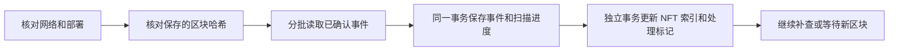

# 链上监听与恢复

更新：2026-10-30。本阶段已实现 NFT 事件保存、所有权与挂牌索引、扫描进度和停机补扫。当前日常入口已使用 Sepolia，NFT 工作台已支持最终确认后的版本 2 清单交接；真实 Sepolia NFT 部署仍待钱包确认，也没有充值订单、游戏币流水或质押奖励结算。监听不会签名、转账或生成新的钱包私钥。

## 运行方式

| 命令 | 作用 |
|---|---|
| `npm start` / `npm run start:demo` | 启动 Sepolia 游戏；存在该环境的 NFT 清单时才启动监听，不自动部署 |
| `npm run indexer` | 单独持续监听 Sepolia 环境；同一环境只允许一个监听进程 |
| `npm run indexer -- --once` | 补查到当前确认边界并退出，适合验证恢复 |
| `npm run chain:record` | 只读补齐旧本地部署记录，不重新部署、不修改游戏账号和资源 |
| `npm run indexer:sepolia` | 读取 `.env.sepolia`，监听 `.local/sepolia/deployment.json` 指定的合约；缺少部署时不能开始扫描 |
| `npm run indexer:sepolia -- --once` | 对 Sepolia 已有部署执行一次补扫，不发交易 |
| `npm run check:sepolia` | 只读检查链 ID 和节点的 finalized 查询能力 |

监听使用与后端同一环境的 `game.sqlite3`，独立于 FastAPI 自动重载运行。Ctrl+C 停止监听，当前批次要么完整提交，要么回滚；不依赖退出时才保存进度。`npm start` 只停止自己启动的进程，启动前遇到占用端口的服务会拒绝继续，需先停止旧服务。独立启动的监听需在自己的终端停止。

本地数据在 `.local/`，Sepolia 数据在 `.local/sepolia/`。自动测试另建临时目录。模板中的 `FORGE_INDEX_BATCH=500` 和 `FORGE_INDEX_INTERVAL=5` 是可修改的运行参数，分别表示每批最多区块数和追上后的检查间隔；范围为 1–2000 块、1–30 秒。节点拒绝大范围查询时缩小批次，最小批次仍失败就保留原进度重试。

## 部署身份与确认边界

部署清单版本 2 在原来的 `address`、`chainId`、`deploymentId`、`mintSigner`、`abi` 上增加：

| 字段 | 核验依据 |
|---|---|
| `deploymentTransaction` | 成功创建当前合约的真实交易回执 |
| `deploymentBlock` / `deploymentBlockHash` | 创建交易所在区块及其哈希 |
| `genesisHash` | 当前网络的创世区块 |
| `runtimeCodeHash` | 当前合约运行代码的哈希 |

新本地部署脚本直接保存这些字段；旧本地部署通过历史代码查询定位创建区块，再核对创建回执，原合约和存档不变。Sepolia NFT 业务部署仍待实现，不能用本地清单或通用验证合约记录替代。

数据库第一次扫描时保存部署指纹，包含上述身份、授权地址、网络及 ABI 摘要。之后更改清单不能覆盖原进度；不匹配时暂停监听。本地 Hardhat 重启后可能重置整条链，即使合约地址相同也不属于原部署。需要继续旧环境时保留原链；测试新部署时使用新的独立数据目录，不删原数据库来消除报错。

**Sepolia 只扫描节点返回的 `finalized` 边界及之前的区块。** 节点不支持或查询失败时停止推进，不回退为 `latest`。部署本身尚未最终确认时显示等待。确认前的交易仍可由市场现有只读查询显示，但不会提前写入这份确认历史。这里没有写死“等几秒就算成功”。以太坊提供的区块标记见[官方 JSON-RPC 说明](https://ethereum.org/developers/docs/apis/json-rpc/#default-block)。

本地 Hardhat 使用 `local-latest`，用于立即验证事件和恢复，不把这个测试策略当作公共链的资金确认策略。未来充值和质押必须另行完成结算验收。

## 保存与处理流程

按合约地址和 ABI 事件主题调用 `eth_getLogs`，核对事件区块哈希、排序并去重。事件身份采用区块哈希和日志序号；当前数据库固定绑定一份部署，因此不会与其他部署混用。区块范围查询方式见[以太坊执行接口规范](https://ethereum.github.io/execution-apis/api/methods/eth_getLogs/)。

`schema_migrations` 记录新增链上结构版本 `chain-index-v1`，迁移不清空现有武器或资源。旧游戏表仍沿用原来的兼容迁移方式，这次没有把所有历史迁移重写。

| 表 | 保存内容 |
|---|---|
| `chain_environment` | 固定的部署身份和公开清单摘要 |
| `chain_scan` | 已扫描、已处理、节点与确认高度、最近成功时间、运行状态和错误 |
| `chain_checkpoints` | 每批完整扫描边界的区块号与哈希 |
| `chain_events` | 事件名、参数、合约、区块、交易、日志序号和处理标记 |
| `chain_nfts` | 已确认 NFT 的所有权、等级、挂牌卖家与价格 |

扫描进度与处理进度分开。处理阶段失败时，已经保存的事件保留，下一次重试只处理未完成记录；NFT 投影与处理标记在同一事务中提交。没有事件的区块也推进扫描边界。token ID 和 wei 金额以十进制字符串保存和传递，避免前端大整数精度丢失。

投影以 `Transfer` 更新归属并清除旧挂单，以 `Listed` / `Unlisted` 更新挂牌，以 `Forged` 补等级。`Purchased` 保存为交易历史，不覆盖接收方回调内可能发生的再次转移或挂牌。现有合约没有卖家提现事件，因此不把提现历史伪装成已经完整索引；可提取收益仍读取合约。

## 异常和恢复

| 情况 | 当前处理 |
|---|---|
| 节点断开、查询限流、某批次失败 | 不跳区块，保留进度并重试 |
| 进程中断或电脑关闭 | 从最近完整提交批次继续；未完成投影重新处理 |
| 一个区间重复扫描或进程重启 | 不重复保存或处理同一事件 |
| 第二个监听进程启动 | 通过同目录文件锁拒绝；进程退出后自动释放锁 |
| 同步读取期间区块改变 | 整批不提交，下一次重新查询 |
| 已保存的确认区块改变、节点高度回退或部署身份变化 | 持久标记 `halted`，保留索引和证据，不自动删库、改余额或解除暂停 |

确认区块冲突时先检查节点是否连错、Hardhat 是否重置、部署清单是否换过。当前没有自动冲正或后台“一键忽略”入口；处理应使用匹配的原链与备份，或另建明确的新测试环境。尚未接入充值与质押，所以监听故障不会擅自修改链下金币。资金模块的恢复和冲正仍须独立实现。

链上历史无法重建链下强化、消费和账号记录。保留数据库、部署清单和原授权密钥；需要备份时使用 SQLite 备份机制，不能仅复制正在写入的主库而遗漏 WAL。

## 页面与接口

“命运集市”增加“链上记录与同步”：显示节点高度、确认边界、扫描和处理高度，以及最近 8 条确认事件。Sepolia 地址与交易可以跳转对应区块浏览器；本地链只显示可复制的记录。页面每 5 秒读取一次，显示停止、补扫、重试或冲突暂停状态。

| 接口 | 用途 |
|---|---|
| `GET /api/health` | 应用存活检查，保持原接口兼容 |
| `GET /api/chain/status` | 监听运行、节点可用性、扫描与处理状态；超过 60 秒无更新会显示停止 |
| `GET /api/chain/events?offset=0&limit=25` | 分页读取已保存的事件和同步状态，最多 100 条 |
| `GET /api/chain/indexed-nfts?offset=0&limit=50` | 已确认 NFT 投影和同步状态，最多 100 条 |
| `GET /api/chain/nfts` | 原有最新链上状态读取，继续供市场交易页面使用 |

市场快照读取最新块；游戏回执与确认历史均等待 Sepolia finalized，但索引处理可能稍晚。游戏页面已区分提交、打包与最终确认，并持久保存已知哈希；钱包加速/取消和广播结果不明的恢复仍未完成，见[交易恢复计划](链上功能与开发计划.md#p0-a游戏交易恢复)。

`caughtUp` 表示已处理到最近读取的确认边界，不代表没有新块。`fundingReady` 当前固定为 `false`，明确表示充值和奖励结算尚未实现。监听不启动时，链下游玩仍可使用；直接链上查询还要求存在正确的 NFT 业务部署清单。当前验证合约记录不能满足该条件。

## 验证方法

`npm run test:backend` 检查重复读取、分批缩小、确认等待、事件处理事务回滚、部署变化、区块冲突、uint256 和真实 Web3 事件格式。`npm run verify:game` 在独立 Hardhat 上执行实际铸造、买卖和转移，再关闭后台、转移 NFT、重启补查，最后模拟已保存区块变化并核对暂停和游戏余额。`npm run test:browser -- chain/tests/browser/chain-history.spec.cjs` 检查同步面板与 SQLite、接口及手机布局的一致性。

本地完整验证报告：`.local/verify-game-Ssh5k2/verification.json`。Sepolia 节点已只读验证链 ID 与 finalized 能力；真实 MetaMask 签名、Sepolia 部署、充值和质押均不属于这份通过记录。

该监听阶段后端完整套件 316 项、同步面板浏览器场景、8 项双语检查及前端构建均通过。当时本地监听已启动并追上原部署，重复启动被文件锁正确拒绝；当前实际运行已改为 Sepolia，NFT 清单未部署时不启动该监听。自动测试使用独立存档和测试链，不向日常游戏账号发放资产。
